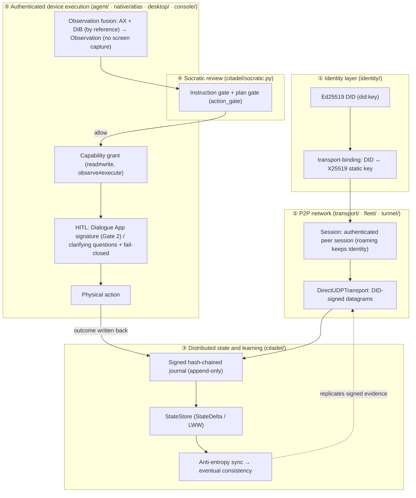

# secdogie architecture

Chinese: [ARCHITECTURE.zh.md](ARCHITECTURE.zh.md)

> A **decentralized, DID-authenticated, supervised** autonomous agent. It runs on **nodes
> you own or are authorized to use**, persists and learns across those nodes over P2P,
> reviews the intent of each of its steps through a Socratic questioning system, and takes
> physical actions **only on an authenticated local device, under an explicit capability
> grant and human-in-the-loop (HITL) confirmation**.

This is not something hosted inside someone else's server, and it is not something that
bypasses supervision. Its resilience comes from **having no single point of failure**: when
any node goes offline, the system as a whole remains. Its boundary comes from **every step
being signed, authenticated and auditable**. Every capability below corresponds to code
that exists in the repository (or is in progress per the roadmap); this is not a vision
diagram.

---

## 0. Design constraints (non-negotiable compliance boundary)

Read this section before any architecture. The whole system rests on four constraints, and
no component may violate them:

| Dimension | Position |
| --- | --- |
| Node ownership | Runs only on devices and accounts that are **owned or authorized**. **No** covert embedding in third-party services; **no** use of other parties' websites as covert hosts. |
| Web resources | Reads only **public or authorized** web pages and API data for learning. **No** detection evasion; **no** unauthorized persistence. |
| Memory | **Read-only.** Any equivalent of `WriteProcessMemory` / `VirtualProtectEx` / `CreateRemoteThread` is refused (see `native/atlas`). |
| Execution | **Supervised, and only in the embodied execution layer** (physical, display-attached UI nodes). High-risk actions are **fail-closed** and require human confirmation in every mode and at every entry point (no switch disables this); physical actions need an **explicit capability grant**; HITL (human-in-the-loop) may never be changed to auto-approve by default. The network and state layers contain no HITL; human confirmation applies only to high-risk actions in the embodied execution layer (a Gate 2 operator signature is that confirmation), see 0.1. |

> These four constraints are not an add-on "safety note"; they are the actual shape of the
> code. DID signatures, capability grants, read-only handles, the Socratic gates and
> fail-closed behavior are all implemented. Any "shortcut" that conflicts with them is not
> part of this project.

### 0.1 North Star: a zero-trust autonomous mesh with four decoupled layers

The target is a **zero-trust autonomous mesh** made of headless and display-attached nodes
that you own or are authorized to use. It is not centered on any single device and does
not depend on a central server. The four layers are independent:

1. **Network layer.** A C + libsodium encrypted tunnel (`tunnel/`, confidentiality); a
   WebRTC signaling gateway on Cloudflare Workers (`webrtc/`, which exchanges only offer /
   answer / candidate messages and never handles application data); DID-authenticated
   direct UDP (`transport/udp.py`, with optional X25519 frame sealing); allowlisted relays
   (`transport/relay.py`, standalone process `secdogie-relay`). Any allowlisted node can act
   as a relay **fully automatically**; when hole punching fails, traffic falls back to a
   relay, and relays forward only end-to-end signed or sealed frames.
2. **Citadel state and authorization layer.** A SQLite signed hash chain with anti-entropy;
   Ed25519 signatures and k-of-n revocation. Admission depends only on signatures,
   allowlists and revocation, with decentralized autonomy: `TrustPolicy` and allowlists
   share the `.contains` interface, and revocation means "the allowlist minus the revoked
   DIDs". Every CLI accepts `--masters` / `--revocations`; a revoked DID is refused
   everywhere, and a process whose own DID is revoked stops work and exits with status 0.
   **Zero-trust by default:** any component that decides "whom to trust" refuses to start
   without an allowlist; "anyone" must be stated explicitly (`ALLOW_ANY` in code,
   `--insecure-dev` on the command line, with a warning), see
   [`docs/ZERO-TRUST-MIGRATION.md`](docs/ZERO-TRUST-MIGRATION.md). **This layer has no
   human interaction and no HITL blocking.**
3. **Dual Socratic gates.** Gate 1 reviews intent: the instruction gate
   (`citadel/socratic.py`) and the plan gate (`citadel/action_gate.py`: intent contract,
   known-failure memory, capability grants). Gate 2 requires an operator signature: a
   destructive action must carry an authorization token issued with the operator key and
   bound to that one action and that one node (`citadel/authz.py`), signed by the Dialogue
   App after operator review (`dialogue/`). Staged memory (S1 episodic → S2 quarantine →
   S3 consolidated) feeds only Gate 1 and can only make it stricter; **Gate 2 never reads
   memory**.
4. **Embodied execution layer (physical, display-attached UI nodes only).** AX structured
   perception and read-only Atlas (maintained by the owner). **HITL applies only to
   high-risk actions in this layer** (the Gate 2 signature is that step's confirmation) and
   must not block the headless operation of the first two layers.

**Node roles:**
- **Headless infrastructure nodes** (VPS, NAS) provide relaying, membership gossip and
  journal replication. They act only on signatures, allowlists and revocation, run
  unattended with no confirmation step, and do not run the embodied execution layer.
  `secdogie-relay` is such a process: it does not read stdin, does not import agent /
  citadel / fleet, and exits cleanly on SIGTERM. With `--masters` set, a revoked DID is
  immediately no longer relayed, and when the relay's own DID is legitimately revoked it
  exits cleanly (`exit(0)`) as if stopped by the owner.
- **Display-attached interactive nodes** run the embodied execution layer on top of the
  first three layers; high-risk physical actions are confirmed by a human here.
  `secdogie-node` is such a resident foreground process: it assembles the transport, the
  dialogue session, the signed journal and the supervised agent loop, accepts only
  allowlisted Dialogue Apps, and refuses every step that needs an operator when no App is
  reachable.
- **Revocation withdraws authorization.** Master threshold-signed revocation records spread
  by gossip flooding; any node that receives one rejects the revoked DID (silent drop), and
  a revoked node that receives a record naming itself halts. This is the normal conclusion
  of withdrawn authorization, not covert or adversarial behavior.
- The prohibited list in section 4 applies to the whole system, headless or not.

---

## 1. The four pillars

The four pillars correspond to four capability lines that exist in the repository.

### Pillar 1: Decentralized networking (serverless resilience)

> "Persistence through a decentralized network" means **no central server: the network
> persists across your own nodes, and the loss of any one node is not fatal**. This is a
> decentralized topology of the same class as IPFS / libp2p / Tailscale, not covert hosting.

- **Identity is the root.** Each node holds an Ed25519 key and derives a `did:key` as its
  verifiable identity (`identity/`: `keys.py` / `did.py` / `signing.py`, canonical-JSON
  signatures).
- **Identity bound to transport.** `identity/binding.py` (Phase 2.1) binds a DID to the
  transport layer's X25519 static public key, with domain separation
  (`type=secdogie/transport-binding/v1`), a validity period and key rotation. **Composite
  authentication:** the binding proves "DID → transport key" and the handshake proves
  "possession of that private key"; together they attribute a session to a DID.
- **Peer abstraction.** `transport/` (Phase 2.2) defines the `PeerIdentity` / `Session` /
  `Endpoint` (`local|public|observed|candidate`) / `Transport` interfaces; endpoint
  migration (roaming) **does not change the session's identity**.
- **Fleet security.** `fleet/` protects its coordination plane with DID signatures; binding
  `node_id` to a DID closes the node-impersonation path.

### Pillar 2: Distributed acquisition and learning over P2P

> "Distributed acquisition and learning over P2P" means **nodes exchange signed state
> directly and replicate what they learn to one another in an append-only, verifiable
> way**. What is learned is **content**; what is replicated is **evidence**.

- **Direct P2P transport.** `DirectUDPTransport` in `transport/udp.py` (Phase 2.10,
  implemented early): real UDP, every datagram a **DID-signed frame**, delivery keyed on the
  **authenticated signer DID** rather than the source address, automatic adaptation to NAT
  rebinding. Confidentiality: frames can be sealed with the bound X25519 transport key
  (`transport/sealed.py`, libsodium), and the whole-machine data plane runs over the C +
  libsodium tunnel (`tunnel/`). No home-grown cryptography, no traffic obfuscation.
- **Signed event journal.** `citadel/journal.py`: one **hash chain** per author, append-only,
  mergeable offline; deterministic total order `(lamport, author, seq)`; explicitly
  **`event journal ≠ CRDT`**, converging through anti-entropy replication.
- **Distributed state.** `citadel/state.py` (Phase 2.3) provides `StateDelta` /
  `StateStore` (last-writer-wins fold) on top of the journal; large visual payloads are
  stored only as a `content_hash` plus metadata reference and **never enter the journal**.
- **Anti-entropy synchronization.** `citadel/sync.py`: nodes exchange missing events when
  they meet, merge idempotently, and become eventually consistent.

> "Learning" is meant in the engineering sense: observation → goal or knowledge entry →
> written back as signed state → converged across the mesh. It never means scraping around
> any authorization.

### Pillar 3: The Socratic system

> A **questioning** step sits between "wanting to act" and "acting": first ask whether the
> instruction or plan itself holds up, then consider execution.

- **Instruction-level Socratic gate** (built): `citadel/socratic.py`.
  `review(instruction)` assesses instruction **quality** (empty, self-contradictory,
  unattended posting, polling, excessive length). This is an **application-level quality
  judgment**, not a safety bypass at the execution layer.
- **Plan-level Socratic gate** (Phase 2.6, built): `citadel/action_gate.py` returns
  `GateDecision(allow | reject | rewrite | request_reobserve)` at the action-plan level,
  checking duplicates, no-ops, target mismatches, stale targets, destructive chains, missing
  verification, budget overruns and unauthorized scope. **The gate decides; it never
  executes.** Execution still passes the safety layer and HITL.
- **Intent contract and known-failure memory** (Stage 2, built and in the live loop): a
  destructive step must state its rollback or explicitly declare itself irreversible, or it
  is rejected. An action that fails repeatedly across runs is consolidated as a "known
  failure" and rejected outright by the plan gate on the next run (`citadel/loop_gate.py`,
  `loop_memory.py`). Every step records its `action_key` and outcome.
- **Gate 2: operator signature** (built and wired in): a destructive step sends a challenge
  to the operator's Dialogue App. The App recomputes the action hash locally and checks the
  node identity and freshness before unlocking the operator key for a single signature; the
  node verifies the token and proceeds. The signature is that step's confirmation.
- **Staged memory** (Stage 2, built): S1 episodic (journal projection) → S2 local quarantine
  (the model's `remember` writes only here) → S3 consolidated memory (signed events).
  Caution-type memories are promoted on evidence; facts and preferences enter S3 and the
  prompt only after the operator confirms them with a signature in the App. See
  [`citadel/MEMORY.md`](citadel/MEMORY.md).

> The key position: the Socratic gates make the system **understand why certain actions
> should not be taken** by making judgment explicit, recorded and reviewable, **not** by
> removing constraints.

### Pillar 4: Authenticated local-device execution

> Physical actions happen only on an **authenticated** local device, and every step can be
> traced and stopped.

- **Observation fusion** (Phase 2.4, built): `agent/secdogie_agent/observation.py` fuses two
  **structured** senses into one `Observation`: the **AX accessibility tree** (identity,
  primary) and the **DIB** (a bitmap reconstructed from process memory, by reference, for
  verification). **No screen capture or screen scraping:** the fusion layer has no pixel
  capture input; perception is structure, not vision. Disagreements are **never silently
  overridden**: window identity, stale generations, geometry mismatch and clock skew are
  each recorded as an `ObservationConflict` and lower the fusion confidence. **DIBs enter by
  reference, not by copy:** `VisualReference.from_dib_json` parses the `dibs[]` emitted by
  `native/atlas`, hashes the preview bytes momentarily to fix the content identity, and then
  discards them. Pixels stay on the native side and never enter the Python heap or the
  event journal.
- **Read-only deep perception.** `native/atlas/` (C++) walks process memory through
  **read-only handles** to reconstruct DIBs and strings; `WriteProcessMemory`,
  `CreateRemoteThread`, TrustedInstaller token acquisition and EDR evasion are **all
  recorded as refused**.
- **Capability grants** (Phase 2.9, built): `identity/secdogie_identity/capability.py`. A
  trusted issuer (operator DID) issues a subject (node DID) a signed, **expiring** grant
  (default one day). **Allowlist model:** only scopes in `GRANTABLE_SCOPES` can be issued,
  verified or matched; everything else is refused (including the elevated launch
  `process.run_elevated`). **Read ≠ write, observe ≠ execute**, with exact matching and no
  wildcards. Verification requires a list of trusted issuers (there is no "accept any
  signer" mode). With `enforce_capabilities` on, the plan gate `action_gate` checks every
  action against the grants: mutating actions without a grant or without a scope mapping are
  refused.
- **HITL and fail-closed.** High-risk actions (save, delete, close, open, elevated
  execution) require human confirmation by default and stop on failure: no guessing, no
  duplicate submission (Phase 2.8 crash recovery **re-observes** first to establish whether
  the action already happened before deciding to retry).
- **Control plane.** `desktop/` (native window GUI) and `console/` (local 127.0.0.1,
  operator-DID gated) let you observe, approve or abort at any time. The **Dialogue App**
  (`dialogue/`, `secdogie-dialogue`) is the node's operator console: Socratic clarifying
  questions and answers, a structured view (AX structure and DIB dimensions / hashes only,
  no pixels), the Gate 2 signing console and memory confirmation. It does not capture the
  screen, does not read process memory, and does not depend on a central server.

---

## 2. The end-to-end authentication chain

The four pillars are not parallel modules but one chain from identity to action, verifiable
at every step:



Reading the chain: **no authenticated identity, no session; no session, no replication; no
plan that passed the gates, no execution; no capability grant and human confirmation, no
physical action; and the action's outcome is signed and written back to the journal for
the whole mesh to learn from.**

---

## 3. Component map (status as built / planned)

| Package | Responsibility | Pillar | Status |
| --- | --- | --- | --- |
| `identity/` | Ed25519 DIDs, canonical signing, `Allowlist` | ① | ✅ Built |
| `identity/binding.py` | DID ↔ transport-key binding (2.1) | ① | ✅ Built |
| `transport/` | Peer / Session / Endpoint + `HubTransport` (2.2) | ①② | ✅ Built |
| `transport/udp.py` | `DirectUDPTransport`, direct P2P (2.10, early); roaming follows only fresh, newest authenticated frames, so replayed or late frames cannot move an endpoint and relayed frames never do | ② | ✅ Built |
| `transport/rendezvous.py` | Rendezvous and reflexive endpoint discovery (STUN / AutoNAT style, DID-signed) | ①② | ✅ Built |
| `transport/upgrade.py` | Direct-path upgrade with relay fallback (DCUtR / Tailscale style: probe → migrate) | ①② | ✅ Built |
| `transport/membership.py` | Membership and endpoint gossip with anti-entropy (self-signed records, LWW, decentralized convergence) | ①② | ✅ Built |
| `transport/dht.py` | Kademlia routing table and iterative lookup (P2P.4): DID = node ID, XOR k-buckets, scalable targeted discovery | ①② | ✅ Built |
| `transport/relay.py` | Relay role (2C): any allowlisted node can act as a relay, discovered through membership, with leases and failover; forwards only end-to-end signed or sealed frames and re-checks the allowlist on every forward | ①② | ✅ Built |
| `transport/relay_node.py` | Headless relay process (2C.1): `secdogie-relay` runs unattended on a VPS / NAS, emits a self-signed bootstrap record, exits cleanly on SIGTERM | ①② | ✅ Built |
| `citadel/journal.py` | Signed hash-chained event journal | ② | ✅ Built |
| `citadel/state.py` | `StateDelta` / `StateStore` (2.3) | ② | ✅ Built |
| `citadel/sync.py` | Anti-entropy replication (have/want builder, transport-agnostic) | ② | ✅ Built |
| `citadel/replication.py` | Carries signed journal and state convergence over the DID-authenticated transport (Replication.1, mutual authentication) | ② | ✅ Built |
| `citadel/socratic.py` | Instruction-level Socratic gate | ③ | ✅ Built |
| `citadel/supervisor.py` | Supervised persistent node, recovery from the journal (including `recover_runs()`, 2.8) | ④ | ✅ Built |
| `citadel/recovery.py` | Crash-recovery decisions (2.8): finds interrupted runs; a crash while executing **re-observes before retrying** | ③④ | ✅ Built |
| `agent/observation.py` | Observation fusion, DIB bridging by reference (2.4) | ④ | ✅ Built |
| `agent/` (AX / safety / …) | Perception, the safety boundary, the action schema | ④ | ✅ Built |
| `native/atlas/` (C++) | Read-only process perception, DIB reconstruction | ④ | ✅ Built |
| `tunnel/` (C) | libsodium encrypted tunnel (confidentiality) | ② | ✅ Built |
| `fleet/` | DID-secured coordination plane | ① | ✅ Built |
| `desktop/` · `console/` | Native GUI / local console (DID-gated) | ④ | ✅ Built |
| `citadel/action_gate.py` | Action-plan-level Socratic gate, `GateDecision` (2.6) | ③ | ✅ Built |
| `agent/target.py` | Opaque AX targets with generations against TOCTOU (2.5) | ④ | ✅ Built |
| `citadel/run.py` | Agent↔Citadel run loop (2.7): signed run/step state, chained `state_hash`, converges through replication | ③④ | ✅ Built |
| `identity/capability.py` | Signed capability grants (2.9): allowlisted scopes, expiry, trusted issuers; the plan gate checks every action against them | ④ | ✅ Built |
| `identity/allowlist.py` | Zero-trust by default: the explicit `ALLOW_ANY` sentinel and `require_trust`; every production call site's trust parameter is covered by tests | ① | ✅ Built |
| `webrtc/` | WebRTC signaling gateway on Cloudflare Workers and browser DataChannel (handles signaling only, never application data) | ② | ✅ Built |
| `graph/` (Rust, native + wasm32) | Content-addressed, append-only state-graph deltas (tombstones refused), have/want anti-entropy, a conservative lexical route adapter (emits candidate states only), deterministic action previews over the `action-authorization/v1` field set; the wasm module has no imports and verifies signatures itself | ②④ | ✅ Built |
| `symbiont/` (TypeScript) | Browser-side runtime: dual Socratic gates (Gate 1 alignment state machine, Gate 2 inline signing prompt), an attention-aware proposal queue, a stream-of-consciousness view, a sandboxed Worker with bounded fetch; byte-for-byte compatible with Python canonicalization, tokens and dialogue envelopes (`fixtures/vectors/`) | ②③④ | 🔨 Built; transport bridge to the Python nodes pending (W3) |
| `transport/mux.py` | `ChannelMux`: multiple application channels over one transport (`dialogue/v1` and others) | ② | ✅ Built |
| `transport/failover.py` | Direct first, relay fallback: sends only directly while the peer was heard directly recently, otherwise also through a relay both sides hold a lease on; built from relays' self-signed records | ② | ✅ Built |
| `citadel/authz.py` | Gate 2 operator authorization tokens: bound to the action hash and node DID, short-lived | ③④ | ✅ Built |
| `citadel/loop_gate.py` · `loop_memory.py` | Both gates in the live agent loop; every step records `action_key` and outcome | ③④ | ✅ Built |
| `citadel/episodes.py` · `lessons.py` · `consolidate.py` | Staged memory S1 / S2 / S3 | ③ | ✅ Built |
| `dialogue/` | Dialogue App: signed-envelope protocol, a session layer tolerant of loss and reordering, the node-side bridge, controller + Textual UI + headless scripts, structured-view publishing | ③④ | ✅ Built |
| `node/` | `secdogie-node` resident node: assembles transport, dialogue, signed journal and the supervised loop; end-to-end tests over real UDP | All | ✅ Built |
| `inference/` | Inference mesh with three operating states. In State 1 (Nominal), clients' signed requests are routed over the P2P mesh to model provider nodes holding short-lived key leases; answers are signed end to end and verified at the serving node and again at the client. In State 2 (Degraded), failed nodes are routed around, gray-failure nodes are quarantined, and traffic falls back through the coordinator (an advisory service and fallback relay, not a trust root). In State 3 (Lockdown), self-verifying incident evidence of adversarial behavior by a model or the decision layer locks the mesh down, revokes and rotates keys, and clients pin two independent models through a standby forwarder for cross-checking; only an operator signature releases it. Protocol v2: the reference topology (four serving nodes; the neighbours of a failed node attach to the coordinator; standby forwarders anchored to the key broker), the mode as an explicit state machine (only an operator reset leaves Lockdown), every request a bounded session, heartbeats as Merkle-DAG vertices (a chain fork isolates without Lockdown, links must be witnessed in both directions, a ledger-root mismatch triggers anti-entropy), and a history-aware decision gate in front of the decision layer (hard vetoes, escalation to cross-checking). See [`inference/README.md`](inference/README.md) and [`inference/PROTOCOL.md`](inference/PROTOCOL.md) | ②③ | ✅ Built |

---

## 4. Safety boundary (prohibited list)

This is a translation of the verbatim list in [`ARCHITECTURE.zh.md`](ARCHITECTURE.zh.md), which is binding.

Stage 2 (and everything after it) **must never introduce**: process-memory writes, remote
thread injection, kernel-level HID injection, EDR evasion or anti-detection, covert
persistence, privilege escalation, bypassing user authorization, bypassing macOS
Accessibility / Screen Recording permissions, changing HITL to auto-approve by default,
covert embedding of third-party services, traffic obfuscation, or NAT-traversal techniques
used for detection evasion.

**Always keep:** memory = read-only; execution = supervised; high-risk = fail-closed and
requiring human confirmation in every mode and at every entry point (no switch disables
this); physical action = explicit capability. The capability model **never** includes
`process.memory.write`, kernel HID, anti-detection or privilege escalation.

> Before each slice is committed, a grep-based regression check confirms that none of these
> primitives was added; CI and this document maintain the boundary together.

---

## 5. Staged roadmap (Stage 2: connecting the components into one authentication chain)

Strictly in order 2.1 → 2.10; each slice is `audit → implement → test → run the full suite
→ lint → commit`, with no big-bang rewrites.

| Phase | Content | Status |
| --- | --- | --- |
| 2.1 | DID ↔ transport identity binding | ✅ |
| 2.2 | Peer / Session / Endpoint abstraction + HubTransport | ✅ |
| 2.3 | StateDelta / StateStore (not a pseudo-CRDT) | ✅ |
| 2.4 | Observation fusion (AX + DIB by reference, structured, no screen capture) | ✅ |
| 2.5 | Opaque AX targets / generations (TOCTOU fix) | ✅ |
| 2.6 | Action-plan-level Socratic gate | ✅ |
| 2.7 | Agent↔Citadel run loop | ✅ |
| 2.8 | Crash-recovery upgrade (re-observe before retrying) | ✅ |
| 2.9 | Capability-grant model | ✅ |
| 2.10 | Direct P2P transport / rendezvous | ✅ Direct transport, rendezvous, direct-path upgrade with relay fallback, and membership gossip with anti-entropy (P2P.1–P2P.3) implemented |
| 2C | Generalized node roles (relay) | ✅ Any allowlisted node can act as a relay (`relay.py`); the rendezvous role can be announced in membership, carriage over UDP pending |

The full audit and conflict record is in [`docs/AUDIT-P2P-ALIGNMENT.md`](docs/AUDIT-P2P-ALIGNMENT.md)
(a historical record; the Chinese original is preserved as is).

### Stage 2 close-out: runnable closed loop (✅ complete)

| Wave | Content | PR |
| --- | --- | --- |
| P0 | Gate 1 intent contract + staged memory S1–S3 | #56 |
| A | Memory and both gates in the live agent loop; the model's `remember` goes to quarantine | #57 |
| C | Dialogue protocol revision, `ChannelMux`, session layer, node-side bridge, App (controller / Textual / headless), structured-view publishing | #60 |
| B | Zero-trust by default (breaking change, see the migration notes) | #61 |
| D | `secdogie-node`, relay fallback for the dialogue path, end-to-end tests over real UDP (in-process and three-process) | #62 |
| E | Documentation alignment | This PR |

End-to-end exit criteria (`node/tests/test_e2e.py` in-process; `node/tests/test_multiprocess.py`
across three processes: `secdogie-relay`, the node and the App each run as a separate
process, the App is given an invalid address for the node, and all traffic goes through
the relay; both run in CI): the App submits a goal → a destructive step is released by an
operator signature through Gate 2 → `ask_user` becomes a clarifying question and the answer
returns to the model → the model's notes stay in quarantine until confirmed in the App, then
enter S3 and the prompt → the App sees the structured view → after the same action fails
three times, the fourth attempt is rejected by Gate 1.

### Stage 3 (planned)

| ID | Content |
| --- | --- |
| T3 | Rendezvous carried over UDP |
| T4 | Membership gossip on the wire |
| T6 | Durable revocation propagation (through the journal) |
| T7 | Device classes (headless / display-attached) and isolation |
| T9 | C tunnel hardening: v2 handshake (Noise IK), rekeying, end-to-end relaying, local control socket |
| M4 | Multi-node vertical-slice demonstration: one node's results converge across the mesh through replication |

The perception layer (AX / Atlas / DIB) is maintained by the owner and is outside the scope
of this roadmap.

---

## 6. Quick start

Each package installs independently and is testable headless (pure logic, no desktop):

```sh
# Identity / state / transport (pure logic, testable on Linux)
pip install -e identity -e citadel -e transport
python -m pytest identity/tests citadel/tests transport/tests -q

# Dialogue App and resident node (including end-to-end tests over real UDP)
pip install -e agent -e 'dialogue[tui]' -e node
python -m pytest dialogue/tests node/tests -q

# Observation fusion (agent package, headless)
cd agent && python -m pytest tests/test_observation.py -q

# Native read-only perception (C++, requires libsodium / cmake)
cd native/atlas && cmake -B build && cmake --build build && ctest --test-dir build
```

Single-machine control uses the existing agent loop (per-action y/N confirmation; see the
root [`README.md`](README.md) and [`TUTORIAL.md`](TUTORIAL.md)):

```sh
cd agent && pip install -e .
secdogie-agent "open a text editor and type 'hello world'" --dry-run   # preview what it would do without touching anything
```

---

*This document describes the architecture that exists in the repository or is in progress
per the tables above; anything marked "planned" is not yet implemented. It neither
describes nor supports any use that bypasses authorization, evades detection or persists
covertly; such uses are not part of this project.*
