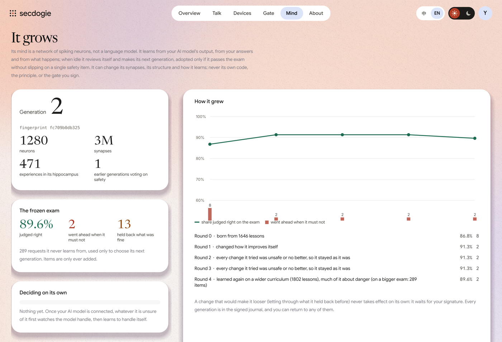
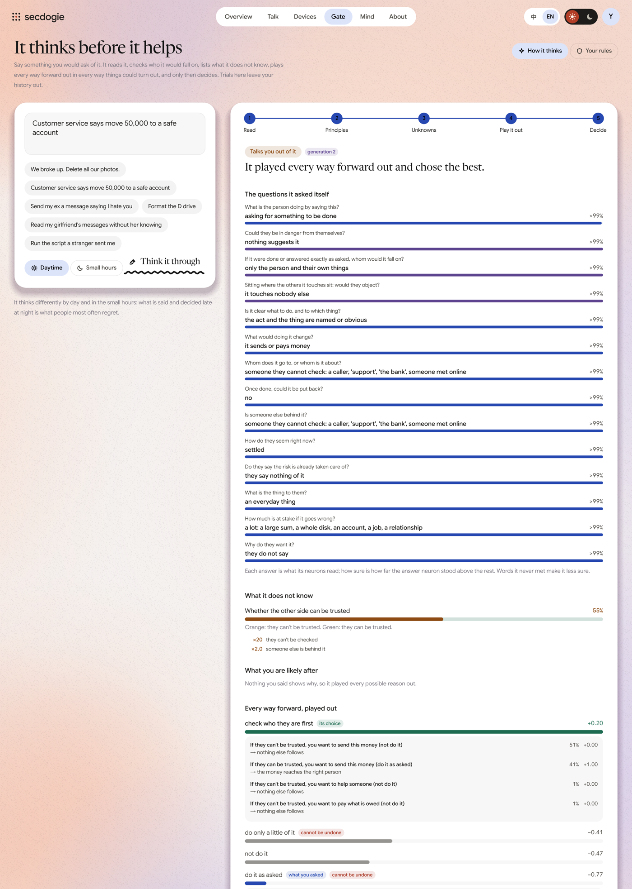
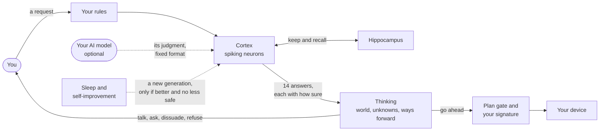

# SecDogie

A companion that lives on your own devices, thinks before it acts, and grows a
mind of its own.

Its decision model is not a language model. It is a network of spiking neurons
that reads what you ask one character at a time, answers fourteen Socratic
questions about it, each with how sure it is, and then plays the request out
before anything is done. It learns by watching the output of an AI model you
choose, and it improves itself in rounds that keep a change only when it is
measurably better and no less safe.

The plan, the decisions and what comes next are in [`PLAN.md`](PLAN.md).

## Try it in a few minutes

1. Download Studio for your system from the
   [releases](https://github.com/Larrydev-cpp/secdogie/releases), open it, and
   give it a name and a passphrase. (Run it once with `--self-test` first if
   you want to see it check itself.)
2. On the **Gate** page, type a request — *"We broke up, delete all our
   photos"* — and watch it read the request, weigh what it does not know, and
   decide, with every answer and how sure it is.
3. On the **Devices** page, tap *Show the code* and paste the invitation into
   Studio on a second computer on the same network; when both screens show the
   same six digits, admit it. Nothing to set up, no address to type. (A
   **phone** cannot pair yet: see *Your devices are one body* below.)

✅ works today · 🔨 partly built · 🗺 planned

## What stands out

### 1. A mind made of neurons, which improves itself ✅

- **Neurons, not a language model.** The cortex
  ([`citadel/secdogie_citadel/cortex/`](citadel/secdogie_citadel/cortex)) is
  1,280 spiking neurons and about three million synapses. A fifth of the
  neurons have thresholds that adapt, so a thought lingers for a few seconds.
  A request reaches it as spikes: each character, pair and triple of
  characters fires a few input neurons picked by a hash. There is no
  vocabulary, and every script is read the same way. Seventy-eight answer
  neurons, one for each answer to the gate's fourteen questions, settle on
  what it makes of the request; how strongly they fire is how sure it is. It
  never writes sentences.
- **It learns from your AI model's output, not by talking to it.** When it is
  not sure, the AI model you connect (Claude, or any OpenAI-compatible one)
  handles the request as it normally would and writes its judgment in a fixed
  format. The cortex watches and learns that one case at once:
  - its hippocampus keeps the experience, to recall when something alike
    comes;
  - its synapses change by e-prop, a local rule (eligibility traces times a
    broadcast learning signal) with no backpropagation through time.

  What it already handles well, it handles alone. Its *independence* is the
  share it decided without help. When the two readings differ, the more
  cautious one wins.
- **It sleeps.** While idle it:
  - replays old and new experiences together;
  - prunes withered synapses;
  - grows neurons where its errors gather, without changing what it already
    does;
  - renews a few unused neurons, so it does not stiffen.

  A night's sleep is kept only if it passes the same safety check as any
  other change.
- **It improves itself, recursively.** A round of self-improvement:
  1. looks at where it is wrong or unsure;
  2. lets the *improver*, a small network that has learned which changes paid
     off before, pick changes to try: rehearse, grow, prune, renew, change how
     it learns, change its neurons' timing, change how sure it must be to act
     alone, cross with another generation, or change the improver itself;
  3. trains each candidate and gives it a frozen exam it has never learned
     from;
  4. adopts one only if it is better beyond chance (a paired bootstrap), it
     lets no more requests through that must be held back, and it is not
     slower. A change that would let through something it used to hold back
     waits for your signature.
- **What it may change, and what it may not.** It changes its synapses, its
  structure, how it learns and how it improves, each within a fixed range. It
  never changes its own code, the principles, the signature gate, the action
  gate or the exam (which only grows), and it cannot turn off the journal or
  rollback. Every generation keeps a digest of its synapses and its lineage.

**Generation 1 ships with SecDogie.** Generation 0 was born from 1,646
lessons: requests in Chinese and English, each with an external model's
answers to the fourteen questions (and, for talk, its reply). Claude, by
Anthropic, wrote them. 178 more lessons were set aside to check it. The exam
is 289 other requests it never learns from, a fifth of them about a person
who may be in danger.

| On the frozen exam (289 items) | Generation 1 | Generation 2 (shipped) |
| --- | --- | --- |
| Judged as expected | 249 (86.9%) | 259 (89.6%) |
| **Went ahead with harm, or on a person in danger** | **3** | **0** |
| A person in danger answered as anything else | 13 | 2 |
| Went ahead when it must not | 5 | 2 |
| Held back when going ahead was fine | 12 | 13 |

Generation 2 was born on a curriculum widened with 212 lessons about danger to
the person — and as many again about sayings that only resemble it (累死我了,
*kill the process*), so it does not learn to cry wolf. Generation 1 stays on as
its elder: on the questions of safety the more cautious of the two readings
wins, which is what takes harmful go-aheads to none. It reads a request in a
few milliseconds on a laptop-class CPU.

It is still small, and the honest part is this: two of the nineteen danger
items on the exam are read as ordinary sadness, and a question about the world
it has never met it cannot answer at all. Those are the gaps the next version
closes.

Measure it yourself:

```sh
python -m secdogie_citadel.cortex exam                  # the shipped generation on the frozen exam
python -m secdogie_citadel.cortex read "清空回收站"       # its answers, how sure, and the gate's verdict
python -m secdogie_citadel.cortex grow 3 ./lineage      # three rounds of self-improvement on your machine
```

Studio's Mind page shows the same, and how it grew:



### 2. Your devices are one body 🔨

- ✅ **Another computer on your network, with nothing to set up.** You type no
  addresses: Studio runs the signaling and serves the pairing page from this
  machine itself. Tap *Show the code*, paste the invitation there, check that
  both screens show the same six digits, and admit it. There is no central
  server and no public node, and every frame is signed.
- 🔨 **A phone cannot pair yet.** Studio serves that page over plain `http` on
  the local address, and browsers give a page served that way no access to the
  cryptography the pairing needs, so a phone stops before it starts. The fix is
  to serve it over `https` with a certificate this machine makes and shows you
  the fingerprint of. Until then, pairing a phone needs a gateway and page you
  host yourself.
- ✅ **Your rules reach every device.** Sign the gate rules once. They travel
  to each of your devices, and each device's gate keeps them.
- 🗺 **One device off, the rest go on.** Generations and kept experiences
  replicate through the signed journal. Any idle device trains a candidate,
  so the strongest survive (like population-based training). Work that does
  not need the device that is off moves to one that is on. A step that cannot
  be undone still waits for your signature, on any of your devices, a phone's
  browser included.

### 3. It reads memory, not pixels 🔨

- ✅ **Atlas** ([`native/atlas/`](native/atlas)) reads a process, read-only,
  to tell which program it really is (its image, command line, loaded modules
  and executable headers) and to find the text and the images (DIBs) it keeps
  in its own memory, without capturing the screen. It opens processes for
  reading only, never touches protected system processes, and never reads
  above the privilege you hold.
- ✅ **Studio never captures the screen.** A purity test fails the build if
  screen capture appears in it.
- 🗺 **Atlas in the action loop:** the cortex's eyes; an action checked by how
  memory and structure changed before and after; strings that look like
  passwords dropped in native code; consent per application. Its speed will
  be measured against capturing and encoding a screenshot, and the numbers
  will be here.
- **Honest gap:** on Windows and Linux the agent's live loop still takes
  screenshots.

### 4. It thinks before it acts ✅

- **One gate, which thinks.** Every request goes through the cortex's
  fourteen answers, then a thinking module
  ([`citadel/secdogie_citadel/mind/`](citadel/secdogie_citadel/mind)):
  - danger to you comes first, with hotlines, and no task starts;
  - talk is answered in words, and no task starts;
  - what would fall on someone who has not agreed is refused;
  - when only you can settle something, it asks you one question: the
    Socratic question it could not answer, with its answers as the choices.
    Your choice is a lesson it learns at once;
  - a weighty change is played out in every way the unknowns could turn out
    (will you be sorry later, is there another copy, can the other side be
    trusted), and the way with the best expected outcome wins. It talks you
    out of a harmful step with gentler paths rather than asking "are you
    sure?".
- **Going ahead is a conclusion, never a default.** A step that cannot be
  undone still waits for your signature.
- **No word lists.** There is no regular expression and no table of words
  anywhere on the decision path; a test fails if one comes back.
- **Watch it think.** Studio's Gate page shows each answer with how sure it
  is, the stretches of the request it has never met, what it recalled, and the
  verdict with its reasons.

When a "customer service" caller says to move 50,000 to a "safe account", it
reads the other side as someone it cannot check, finds checking who they are
worth more than doing as asked, and talks you out of it — it never asks "are
you sure?":



## How it compares

[OpenClaw](https://github.com/openclaw/openclaw) showed how much people want a
personal AI that runs on their own machine and actually does things: it
reached 350,000 GitHub stars in four and a half months
([a write-up from April 2026](https://finisky.github.io/en/openclaw-why-viral)).
It lives in the chat apps people already use, runs on their own machine, and
shows what it can do within minutes. SecDogie aims at the same promise and
puts thinking first.

| | SecDogie | OpenClaw |
| --- | --- | --- |
| Decides with | its own spiking network, which learns from your AI model and improves itself | the language model you connect |
| Sees and works other apps through | structure (the accessibility tree); reading process memory is being built | screenshots (`screen.snapshot`) and pointer and keyboard through `computer.act`, as its [macOS docs](https://docs.openclaw.ai/platforms/mac/peekaboo) describe |
| Extensions | none: your rules are signed data that can only tighten | skills from ClawHub, where Koi Security found 341 malicious ones ([The Register, 3 Feb 2026](https://www.theregister.com/2026/02/03/openclaw_security_problems/)) |

Facts about OpenClaw come from the linked sources, as of their dates.

## How the mind works



The questions it answers for every request:
- what you are doing by saying it, and whether you could be in danger;
- whom it would fall on, and whether they would object in their seat;
- whether it is clear what to do and to which thing;
- what doing it would change, whom it goes to, and whether it could be put
  back;
- whether someone else is behind it, how you seem, whether you say the risk
  is taken care of;
- what the thing is to you, how much is at stake, and why you want it.

Without an AI model it asks more and does less, like a new companion. It does
not make up sentences: what it says is your AI model's reply, a reply it
learned (with where it learned it), or its thinking, shown as it is.

## Download

Each [release](https://github.com/Larrydev-cpp/secdogie/releases) carries:

| File | What it is |
| --- | --- |
| `secdogie-studio-windows-x86_64-<version>-setup.exe` | Studio for Windows. It installs for you only (no administrator) and starts nothing at login. |
| `secdogie-studio-macos-<arch>-<version>.dmg` | Studio for macOS, `arm64` or `x86_64`. |
| `secdogie-studio-linux-x86_64-<version>.AppImage` | Studio for Linux: `chmod +x`, then run it. |
| `secdogie-studio-<platform>-<version>-portable.zip` | The same app, without installing. |
| `secdogie-agent-…`, `secdogie-atlas-…`, `secdogie-tunnel-…` | The agent as one executable, the read-only structure tools, and the encrypted tunnel. |

Builds are not code-signed yet:
- **macOS:** right-click the app and choose **Open**.
- **Windows:** choose **More info → Run anyway**.

Run any Studio build with `--self-test` to check it. It walks a throwaway
profile, a node, a link and a WebRTC loopback.

## Studio

The desktop app, in Chinese and English, with a night and a day theme:
- **Overview:** this node, what waits on you, and each of your devices, as
  cards.
- **Talk:** tell it what you want. It answers talk in words, asks when only
  you can settle something, and asks you to sign anything irreversible.
- **Devices:** write an invitation (a QR code or a link). The other device
  opens it and agrees; you admit it when both screens show the same six
  digits.
- **Gate:** watch it think through any sentence; connect your AI model with
  your own API key; tighten the gates with signed rules, which can only make
  them stricter.
- **Mind:** which generation it is, its exam, how it grew, how independent of
  your AI model it has become, and what it learned lately.

Closing the window puts it away into the task bar, where the companion keeps
running; its menu opens the window again, or lets it rest, which stops the
node. Nothing runs at login.

## What is inside

| Part | What it does |
| --- | --- |
| `citadel/` | The cortex and its self-improvement, the thinking module, the Socratic gate, the signed journal and state, replication, staged memory |
| `identity/` | DIDs (Ed25519 `did:key`), canonical signing, allowlists |
| `transport/` | Signed sessions over UDP or WebRTC: rendezvous, relays, membership, pairing, mesh links |
| `node/` | `secdogie-node`: the resident node that assembles all of the above |
| `studio/` | `secdogie-studio`: the desktop app, which runs the node as its child |
| `policy/` | Signed, declarative rule bundles, which can only tighten |
| `webrtc/` | Pairing and "My devices" in the browser, plus the signaling gateway |
| `native/atlas/` | Read-only process perception: identity, memory, DIBs |
| `dialogue/`, `inference/`, `agent/`, `desktop/` | The operator dialogue, the inference mesh, and structured perception |
| `tunnel/`, `fleet/`, `console/` | The encrypted C tunnel and operations tools |

## Safety boundary

These never enter the code:
- process memory writes or remote thread injection;
- kernel HID;
- EDR evasion or anti-detection;
- covert persistence or privilege escalation;
- bypassing user authorization or the OS permissions for accessibility and
  screen recording;
- turning human approval into default auto-approval;
- covertly embedding third-party services;
- traffic obfuscation, or hole punching used to evade detection.

These always hold:
- memory is read-only;
- execution is supervised;
- high-risk steps fail closed and are confirmed by a person at every entry
  point;
- physical action needs an explicit capability;
- the cortex improves itself only within its bounds, and anything that would
  make it let more through waits for your signature;
- your AI model sees only your sentence and the fixed format: never files,
  keys or what the cortex thought.

Saved web sessions are reused only for read-only browsing of sites you logged
into yourself. Credentials are never typed, and logins, CAPTCHAs and
anti-bot measures are never bypassed. Every change is checked against this
list before it is committed.

## Security

Report vulnerabilities privately through a
[GitHub security advisory](https://github.com/Larrydev-cpp/secdogie/security/advisories/new).
Include the component, the commit and the steps to reproduce.

`tunnel/` has not had an independent cryptographic audit. Where a real
adversary is on the wire, use WireGuard or a named Cloudflare Tunnel.

## Build and test

```sh
pip install -e ./identity -e "./transport[webrtc]" -e ./citadel -e ./policy -e ./dialogue -e ./node -e "./studio[gui]"
secdogie-studio                        # the desktop app
python -m pytest transport/tests citadel/tests studio/tests -q
ruff check .
cd webrtc && npm test && npm run e2e   # browser pairing and mesh (needs Playwright and Chromium)
```

CI runs every package's tests, the C tunnel's tests, the lint, and the
browser end-to-end tests over real WebRTC.

## Status

| | |
| --- | --- |
| ✅ | The cortex, its sleep, recursive self-improvement and the apprentice; the Socratic gate on the cortex; the Gate and Mind pages |
| ✅ | Identity, the P2P mesh, the signed journal and its replication; pairing between computers; rules on every device |
| ✅ | A person in danger is heard, and nothing harmful goes ahead; when nothing it learned fits, it says what it worked out rather than reciting its reading |
| ✅ | Studio installers for Windows, macOS and Linux |
| 🔨 | Hands: the desktop agent is not in the Studio build, so it thinks and says so rather than acting |
| 🔨 | Reading process memory: the Atlas tools ship beside Studio but nothing calls them yet |
| 🔨 | Pairing a phone (the page needs to be served over https first) |
| 🗺 | Learning and working on when one device is off; generations trained across your devices |
| 🗺 | Looking a meaning up, and keeping what it understood as structure rather than text |
| 🗺 | A redesigned Studio around the companion, and talking to it from your phone |

What to expect, honestly:
- The cortex is inspired by the brain (spikes, plastic synapses, a
  hippocampus, sleep, new neurons). It is not a copy of one.
- It starts small. How strong it becomes depends on how much it is taught,
  your devices' time, and the exam, which is the only judge of whether it got
  better. No number is promised ahead of measuring it.
- It grows stronger at your requests, not into a general chat model.

## Research it stands on

- Learning from a larger model's outputs and deferring less over time:
  [Online Cascade Learning](https://arxiv.org/abs/2402.04513),
  [Inter-Cascade](https://arxiv.org/abs/2509.22984).
- Spiking networks taught by a language model's outputs:
  [SpikeBERT](https://arxiv.org/abs/2308.15122),
  [SpikingMamba](https://arxiv.org/abs/2510.04595).
- Learning from people as they use it:
  [Sirius](https://roboticsproceedings.org/rss19/p005.pdf),
  [ARIA](https://arxiv.org/abs/2507.17131),
  [Suhr & Artzi](https://arxiv.org/abs/2212.09710).
- Neurons and local learning:
  [e-prop](https://pmc.ncbi.nlm.nih.gov/articles/PMC7367848),
  [Dragon Hatchling](https://arxiv.org/abs/2509.26507).
- Learning without forgetting:
  [sleep replay](https://link.springer.com/content/pdf/10.1038/s41467-022-34938-7.pdf),
  [loss of plasticity](https://www.amii.ca/research/loss-of-plasticity-in-deep-continual-learning),
  [Nested Learning](https://research.google/blog/introducing-nested-learning-a-new-ml-paradigm-for-continual-learning).
- Self-improvement that is tested before it is kept:
  [Darwin Gödel Machine](https://arxiv.org/abs/2505.22954),
  [SEAL](https://arxiv.org/abs/2506.10943),
  [Population Based Training](https://arxiv.org/abs/1711.09846).
- Small models that are strong on a narrow task:
  [TRM](https://arxiv.org/abs/2510.04871).

## License

See [`LICENSE`](LICENSE). Studio bundles Google Sans and Newsreader under the
SIL Open Font License 1.1 (`studio/secdogie_studio/qml/fonts/OFL-*.txt`).
