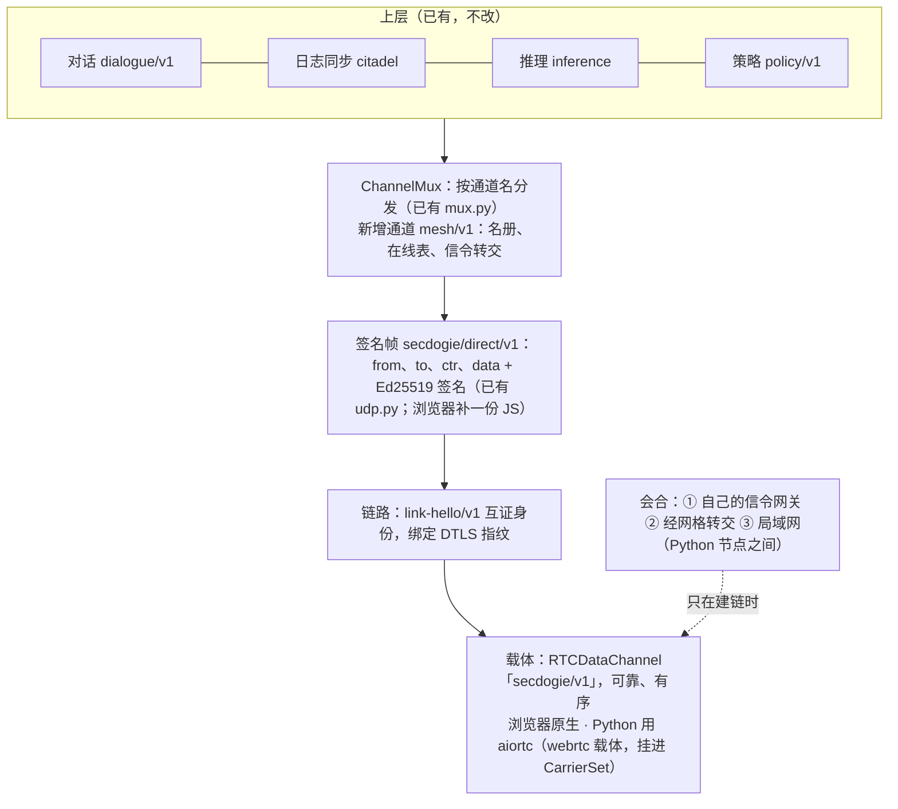
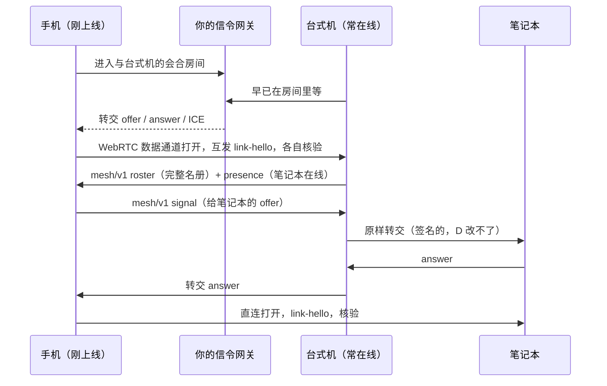

# 自己的设备组成的网格：WebRTC 架构计划

> 2026-11，机主定：「整个项目都改成自己节点跑，在浏览器上点击确认或 agree，使用 WebRTC 连接。」
> 配对已经做完（`webrtc/pair.html`，见 `PLAN-STUDIO-INGEST.zh.md` §4.4c）。本文接着回答：**配对之后，这些设备怎么一直连在一起、互相说话。**

## 0. 结论先行

1. **网格 = 你的设备。** 名册里只有主人签过接纳书的设备，别的一概不连。没有公开节点，没有种子节点。
2. **设备之间全部走 WebRTC 数据通道直连。**
   - 浏览器原生支持；Python 节点用 aiortc。
   - 自己的设备一般不超过十几台，所以**全互连**：每台在线设备和其他每台在线设备各有一条链路。
3. **一条链路要过三道关才算数：**
   - DTLS 加密（浏览器自带）；
   - 双方签名的 `link-hello/v1` 互证身份，并绑定这条连接的证书指纹（沿用配对的 bind）；
   - 链路上每一帧仍是 DID 签名的 `secdogie/direct/v1`，和 UDP 上的帧一模一样，所以上层（对话、日志同步、推理）不用改。
4. **信令只是会合点，并且越用越少：**
   - 第一条链路靠你自己部署的信令网关建立；
   - 有了一条链路之后，新链路的信令经已连上的设备转交；
   - 网关只看得到「谁想连谁」的密文协商，看不到内容。
5. **一切由人显式开始。**
   - 浏览器设备点「上线」才连，关掉标签页就下线：没有 Service Worker，没有后台常驻。
   - Python 节点只在你运行它时在线。

## 1. 设备的三种角色

| 角色 | 例子 | 在线时间 | 跑什么 |
| --- | --- | --- | --- |
| **常在线** | 书房的台式机、NAS、家里的小服务器（`secdogie-node`） | 一直 | 日志、苏格拉底门、决策模型、推理、在别的设备连不上时替它们转发 |
| **交互端** | Studio 所在的电脑 | 开着 Studio 时 | 对话、签名、看节点状态 |
| **随身** | 手机、平板、别人电脑上的浏览器标签页 | 页面开着时 | 收提醒、批准、看状态；不跑规则 |

接纳书里的 `roles`（`forward`、`serve`、`model`、`relay`、`ingest`）决定一台设备能承担哪些活。默认只有 `forward`。

## 2. 分层

### 2.1 载体：数据通道

- 每对设备一个 `RTCPeerConnection`，里面一条可靠、有序的数据通道 `secdogie/v1`。以后需要再加一条不可靠的通道（比如实时状态）。
- 浏览器端把 `web_peer.js` 改成可以多实例的 `PeerLink`（一条链路一个实例）。现有的单实例 API 包一层保留，配对页不用改。
- Python 端新增 `webrtc` 载体：
  - 跑在已有的 `AsyncCarrierHost` 事件循环上，挂进 `CarrierSet`；
  - 地址写成 `("rtc", <对方 DID 的短哈希>)`；
  - `DirectUDPTransport` 的签名、防重放、按 DID 投递全部照旧。

### 2.2 链路认证：`link-hello/v1`

数据通道一打开，双方各发一份：

| 字段 | 含义 |
| --- | --- |
| `mesh` | 网格名 |
| `did` | 自己的 DID |
| `nonce` | 随机数 |
| `local_fp` / `remote_fp` | 自己看到的两张 DTLS 证书指纹（同配对） |
| `ts` | 时间（允许 ±120 秒） |
| `admission` | 自己的接纳书（主人自己则为空） |
| `roster` | 自己手上名册的摘要，用来判断要不要同步 |

收到的一方逐项核对：
- 签名是 `did` 的；
- 指纹交叉对得上（对不上 = 信令中间有人，立刻断开）；
- `did` 是主人，或者 `admission` 由主人签名、属于这个网格、给的就是这个 `did`，并且没被撤销；
- 时间新鲜。

**每次新连接的证书都是新的**，所以旧的 hello 拿到别的连接上用不了。

### 2.3 帧和通道

- 链路上传的就是 `secdogie/direct/v1`：`{t, from, to, ctr, data}` 加签名，和 UDP 上的一样。浏览器端补一份 JS 实现，用金向量锁住，跟 Python 逐字节一致。
- 帧里面按 `ChannelMux` 的格式分通道。新增 `mesh/v1` 通道，承载：

| 消息 | 作用 |
| --- | --- |
| `roster` | 名册：主人列表 + 全部接纳书 + 撤销书。合并 = 验得过的接纳书取并集，再去掉被撤销的 |
| `presence` | 谁在线、各自经哪条路连着（直连 / 中继）、往返时延 |
| `signal` | 替两台还没连上的设备转交 offer / answer / ICE（§3） |
| `ping` | 测往返时延 |

### 2.4 名册

- **从哪来：**
  - 主人设备有它接纳过的全部设备；
  - 新设备配对时只知道主人；
  - 第一次连上主人设备后，拿到完整名册，然后去连名册里其他在线的设备。
- **撤销：** 主人签 `device-revocation/v1`（网格、设备 DID、时间）。撤销书和接纳书一起在名册里传播，被撤销的设备再也过不了 `link-hello`，已有链路当场断开。
- **多个主人：** 允许，比如浏览器里的主人钥匙加上 Studio 的操作员钥匙。主人钥匙丢了怎么办，见 §7 的待定问题。

## 3. 会合（信令）

- **会合房间：** `room = "l-" + base32(sha256("secdogie/link-room/v1|" + 网格 + "|" + 两个 DID 排序后拼接))` 取前 32 位。
  - 两台设备各自算得出，现有网关一个房间两人的规则正好合用，**网关一行不用改**。
  - 已知的限制：知道这两个 DID 的人可以抢先占住房间。这只能让两台设备暂时连不上，冒充不了（过不了 `link-hello`）。§3 第三项会彻底解决。
- **经网格转交：** 有了第一条链路之后，后面的链路都可以不碰网关。转交的设备只是传话；协商内容由发起方签名，转交方改不了。
- **网关升级成 DID 认证的信箱**（= ROADMAP W1 / 计划 F4）：
  - 设备连上网关时用 DID 签一个挑战，网关按 DID 投递，一台设备只需一条 socket；
  - 设备还可以告诉网关「只收名册里这些 DID 的消息」，网关代为挡掉别人；
  - 这一步做完后，按对房间就退役了。
- **局域网：** Python 节点之间可以直接用局域网信令（节点自己当网关）。浏览器页面在 https 下只能连 `wss://`，而局域网里很难有合法证书，所以浏览器还是走你部署的网关，或者经网格转交。

## 4. 连不上的时候

| 情况 | 办法 |
| --- | --- |
| 一方在对称 NAT 后，打洞失败 | 换另一方当发起方再试一次 |
| 两边都打不通 | **经常在线的自己设备转发**：帧本来就签了名（需要时还加密封装 `sealed.py`），转发的设备看不懂也改不了。这正是已有 `relay.py` 的做法，现在搬到链路上 |
| 没有任何常在线设备 | 可选：在自己的服务器上跑 TURN（coturn），把地址写进配置；不配就是暂时离线 |
| 浏览器标签页被系统挂起 | 页面回到前台时自动重连；在后台时就算离线，不偷偷保活 |

## 5. 安全边界（与项目红线一致）

- **显式开始，没有后台：**
  - 浏览器设备只在点「上线」之后连；没有 Service Worker，没有后台同步，关页面即下线；
  - 节点只在你运行它时在线。
- **钥匙不出设备：** 浏览器钥匙是 IndexedDB 里不可导出的 `CryptoKey`，Python 钥匙照旧在本机文件里。
- **只认主人的签名：** 名册只接受主人签过的接纳书和撤销书。链路上的别的设备说什么都不算数，只能传话。
- **信令看到的：** 房间名（哈希）、SDP、ICE 候选（含 IP）、各自在线的时间。看不到名册、DID、内容。
- **不做混淆，不做反检测：** 就是标准的 WebRTC，加签名。
- **规则只在自己的设备上跑**（`PLAN-STUDIO-INGEST.zh.md` §5.7 不变）；随身设备不跑规则，只接收结果和请求批准。

## 6. 代码落在哪里

| 位置 | 内容 | 状态 |
| --- | --- | --- |
| `transport/secdogie_transport/pairing.py` · `webrtc/client/pairing.js` | 配对 | ✅ |
| `transport/secdogie_transport/meshlink.py` | 参考实现：会合房间、`link-hello/v1`、名册（合并、撤销）、`mesh/v1` 消息 | 新 |
| `webrtc/client/meshlink.js` | 同上的浏览器实现，金向量 `fixtures/vectors/meshlink.json` 锁住 | 新 |
| `webrtc/client/frames.js` | `secdogie/direct/v1` 签名帧 + 通道复用的浏览器实现（对齐 `udp.py`、`mux.py`） | 新 |
| `webrtc/client/web_peer.js` | 拆出可多实例的 `PeerLink`；原 API 保留 | 改 |
| `webrtc/client/mesh.js` | 浏览器设备：名册、按对房间建链、链路认证、在线表、重连、信令转交 | 新 |
| `webrtc/mesh.html` | 「我的设备」：名册、谁在线、经哪条路、时延，「上线 / 下线」，发一句话试试 | 新 |
| `transport/secdogie_transport/webrtc_carrier.py` | Python 的 `webrtc` 载体（aiortc，可选依赖 `secdogie-transport[webrtc]`） | 新 |
| `node/` | `--mesh`、`--signal`、`--admissions`；读取接纳书目录（= S4）；`secdogie-node pair <请帖链接>` 在终端里配对并显示六位数 | 改 |
| `webrtc/signaling/worker.js` | DID 认证信箱（W1） | 改（后期） |

## 7. 切片

接着 `PLAN-STUDIO-INGEST.zh.md` 的 S1–S4 往下编号。每片单独可测、单独提交。

| 编号 | 切片 | 完成判据 |
| --- | --- | --- |
| **S5** ✅ | 浏览器设备上线：按对房间建链 + `link-hello/v1` + 名册 + 签名帧 + `mesh.html` | 三个真实浏览器（主人、手机、平板）：手机连上主人后拿到名册，自动连上平板；名册外的设备、指纹不符的设备被拒；关掉一个标签页，其他两台看到它下线 |
| S6 | 撤销 + 名册传播 | 撤销后被撤销设备的链路当场断开，且再也连不上；名册在三台之间收敛 |
| S7 | 经网格转交信令 | 网关断开后，已在线的设备之间仍能建新链路 |
| S8 | Python `webrtc` 载体（aiortc）+ 节点入网 + `secdogie-node pair` | 一个 Python 节点和两个浏览器组成网格；对话通道经 WebRTC 跑通 `node/tests/test_e2e.py` 的同一场景 |
| S9 | 经常在线设备转发 | 模拟两台设备之间不能直连：消息经台式机转发，台式机改不了也读不了（封装时） |
| S10 | 网关 DID 认证信箱（W1） | 一条 socket；未签名、重放、冒名的连接被拒；只收名册内 DID 的消息 |
| S11 | Studio「我的设备」页 | 节点页显示网格里的设备、在线状态和路径 |

**S5 落地记录（2026-11）：**
- 协议：`meshlink.py` / `meshlink.js`，签名帧 `frames.js`，金向量 `fixtures/vectors/meshlink.json`；
- 运行时与页面：`webrtc/client/mesh.js`、`webrtc/mesh.html`；`web_peer.js` 新增 `createPeerLink()`，原有 API 不变；
- 测试：`webrtc/tests/e2e/mesh.e2e.cjs` 用三个真实浏览器验证上面的判据。
- 「名册外的设备、指纹不符的设备被拒」由协议单测覆盖（Python 与 JS 两边），端到端测试覆盖其余几条。

## 8. 待定问题（需要机主拍板）

1. **主人钥匙放哪？**
   - 现在在第一台写请帖的浏览器里。浏览器数据被清掉，就再也接纳不了新设备（已接纳的设备不受影响）。
   - 建议：允许多个主人。Studio 的操作员钥匙也作为主人，两边各存一把。
2. **信令网关部署在哪？** 建议用你自己的 Cloudflare 账号部署 `webrtc/signaling`，配对页和「我的设备」页放同一个域名的 Pages 上（https）。
3. **随身设备要不要能「批准」高风险操作？** 技术上可以（签名在手机浏览器里完成）。是否开放由你定；默认只看不批。
