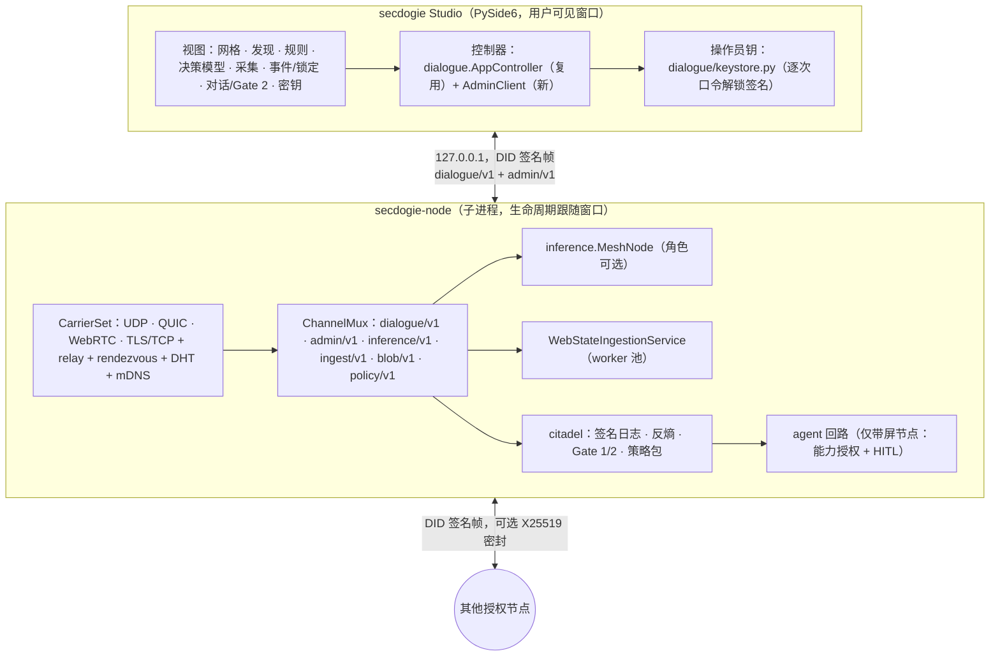

# 计划：Studio 桌面应用 · 多协议传输 · 策略注入 · 分布式结构化采集

> **状态：规划中，本文件对应的代码还没有写。**
> 输入有三份：手绘图（① new arc；② 当节点失效，连接中央 server；③ 决策模型叛变时）、
> 《TECHNICAL SPECIFICATION & ENGINE REFACTORING》§1–§2，以及桌面应用需求。
> 需求是 Mac / Linux / Windows 三平台带 GUI 的应用程序，能在本地连接 P2P 节点，
> 能把苏格拉底门和决策模型注入网格、写入规则，能寻找节点，传输层用 WebRTC 等。
> 纪律同 [`ROADMAP.md`](../ROADMAP.md)：每个切片走「审计 → 实现 → 测试 → 跑全量 → lint → 提交」；
> 全部 headless / loopback 可测；状态如实标注。

---

## 0. 结论先行

1. **手绘图的三态已经在 `inference/` 实现了**（#75），不用重做，只需补三个缺口（§2）。
2. 新增工作分为六条轨道：

   | 轨道 | 内容 |
   | --- | --- |
   | **N 多协议传输** | 在现有 DID 签名帧下面抽出「载体」接口。UDP 保留，新增 TLS/TCP、QUIC、WebRTC DataChannel 三种载体，外加分块的内容寻址 blob 传输。 |
   | **F 节点发现** | 邀请码、局域网 mDNS、rendezvous（已有）、DHT 上线、信令网关 DID 认证。 |
   | **P 策略包** | 苏格拉底门规则和决策模型配置，以**操作员签名的声明式数据**发布到网格。**不下发代码**，规则**只能让门更严**。 |
   | **I 采集引擎** | `WebStateIngestionService`：按 origin 分片的分布式结构化采集。DOM / 嵌入 JSON / AX 统一转成规范化 JSON，没有视觉模型，不处理像素。 |
   | **G Studio** | 桌面应用。PySide6 GUI 作为操作员端，`secdogie-node` 作为子进程，两者经回环、DID 认证的通道通信。 |
   | **K 打包** | Windows `.exe` 安装包、macOS `.app` / `.dmg`、Linux AppImage / `.deb`。 |

3. **「找 P2P 节点，用 WebRTC 差不多就可以吧？」——WebRTC 解决「连上」，不解决「找到」。**
   它适合做一种载体，用于穿 NAT、走 TURN 兜底、与浏览器互通。「找到」靠签名记录加
   rendezvous / DHT / gossip / mDNS / 邀请。现在的信令网关一房间只容两人、没有身份认证，
   要先升级才能给网格用。详见 §4.3。

---

## 1. 手绘图对照现有代码

| 手绘图 | 代码 | 状态 |
| --- | --- | --- |
| central server / c/s | `inference/coordinator.py` `Coordinator`：签名公告、修复计划、中央兜底通路；不是信任根 | ✅ |
| API key | `inference/broker.py` `KeyBroker`：上游密钥以短租约借出，密封到模型节点的 X25519 公钥 | ✅ |
| M/API (P2P) | `MeshNode(roles={"model"})`：用租约密钥作答，每个回答都签名 | ✅ |
| P2P+S / S+P2P | `MeshNode(roles={"serve","forward"})`：决策层，负责选路、裁决、签 decision | ✅ |
| P2P / new P2P | `MeshNode(roles={"forward"})`：只转发；状态 ② 中被招募，状态 ③ 中作为用户入口 | ✅ |
| ② (wrong) P2P | `Suspicion` 加 `FaultTracker`：至少两个不同报告者才隔离，之后观察期，再恢复 | ✅ |
| ② 连接中央 server | `Router` 第 3 步：`decider → coordinator → provider` 的 central leg | ✅ |
| ③ 决策模型叛变 | `mutiny.py`：可自证的证据、全网锁定、密钥轮换、双模型交叉验证，只有操作员签名的 `make_reset` 能解除 | ✅ |
| user | `UserClient`：签请求，自己再验一遍每个回答 | ✅ |

手绘图里的「决策模型」就是 `MeshNode` 的 `policy`（默认是确定性的 `Router`）。
§5.4 讲的「注入决策模型」，指的就是替换这个 `policy` 的**配置**。替换之后，节点签名前的自检
（`node.MeshNode._decide`）仍然保留。

## 2. `inference/` 的三个缺口（本计划顺带补上）

| 编号 | 缺口（出自 `inference/README.md` 的 Honest limits） | 做法 |
| --- | --- | --- |
| INF-1 | 一帧一个数据报，输入和输出各 ≤ 8000 字符 | 改走 §4.6 的 `blob/v1`。帧里只放 `input_hash` 与大小，正文分块传输 |
| INF-2 | 事件 / 重置台账只在内存里 | 写进 citadel 签名日志（仿照 `RevocationStore`），重启后从日志恢复锁定状态 |
| INF-3 | 转发节点能看到 prompt | 用户把输入密封给每个 pin 的模型节点（锁定态下已知 pin）。常态下由决策节点在 decision 中给出各 leg 的模型节点 X25519 公钥，用户再按 leg 密封。需改协议版本，单列切片 |

---

## 3. 总体结构



几条原则：

- **Studio 只是另一个操作员 App**，不是新的信任根。操作员私钥只留在 Studio 进程里，节点进程永远拿不到。
  Gate 2 签名、策略包签名、锁定重置签名都在 Studio 本地完成。
- **节点仍然是 `secdogie-node`**。Studio 只负责启动它、给它配置、通过回环与它说话。
  无头节点（VPS、NAS）照旧用命令行，不需要 Studio。
- **不新增密码学**。签名、密封、撤销、门限仍复用 `secdogie-identity`、PyNaCl 与 `MasterSet`。

---

## 4. N + F：多协议传输与节点发现

### 4.1 载体接口（N0，纯重构）

现在 `transport/udp.py` 的 `DirectUDPTransport` 把「DID 签名帧 + 重放窗口 + 漫游规则」和「UDP socket」
绑在一起。拆成两层：

```
DirectTransport（原 DirectUDPTransport 的帧逻辑，帧格式 secdogie/direct/v1 不变）
  └─ Carrier 接口：kind · mtu · reliable · send(addr, bytes) · on_receive(cb(addr, bytes)) · close()
       ├─ UdpCarrier      （从 UDPChannel 抽出，行为不变）
       ├─ TlsTcpCarrier   （新，N1）
       ├─ QuicCarrier     （新，N2）
       └─ WebRtcCarrier   （新，N3）
```

- 端点从 `(host, port)` 扩成 `(carrier_kind, addr)`。漫游规则逐字保留，且按载体分别执行：
  只有最新一帧经过认证的帧才能移动端点，重放帧不行，中继帧也永远不行。
- **完成判据**：`transport/tests`、`node/tests`、`inference/tests` 不改一行，全部通过。

**并发模型**：现有传输基于线程（`UDPChannel` 是线程 + 0.2 s 超时），而 aiortc / aioquic 是 asyncio。
做法是每个进程只起一个 asyncio 循环，放在守护线程里（`AsyncCarrierHost`）。
载体回调经线程安全队列交还给 `DirectTransport` 的投递线程，上层代码不改。

### 4.2 四种载体

| 载体 | 库 | 用途 | 身份绑定（防信令 / 证书中间人） |
| --- | --- | --- | --- |
| UDP | 标准库（已有） | 默认首选：低延迟控制帧、打洞 | 帧本身 DID 签名，可选 X25519 密封（已有） |
| QUIC | `aioquic` | 大块数据走 stream，控制帧走 datagram 扩展；ALPN `secdogie/1` | 自签证书的 SPKI 哈希写进**自签名成员记录**，按 DID 钉住证书 |
| WebRTC DataChannel | `aiortc`（见 §10 决定 2） | 对称 NAT 下走 ICE / TURN；与浏览器节点（`symbiont/`）互通，对应 ROADMAP 的 W3 | DataChannel 打开后，双方互发 `carrier-bind/v1`：DID 签名覆盖**双方 DTLS 指纹**与对方 nonce。指纹不符即判定信令中间人，直接断开 |
| TLS / TCP | `asyncio` + `ssl` | UDP 被封的网络（如公司网络只放行 443）；帧格式为长度前缀 | 同 QUIC，按 DID 钉住 SPKI |

- 即使信令或证书被中间人劫持，**也伪造不了身份**，因为每一帧都有 DID 签名。载体层绑定额外保证机密性，
  且在不开密封时也能发现中间人。最坏情况只是拒绝服务。
- **选路（N4）**：成员记录新增 `carriers` 字段，例如
  `[{"k":"udp","a":"…"}, {"k":"quic","a":"…","spki":"…"}, {"k":"webrtc","sig":"wss://…","box":"<DID>"}, {"k":"tls","a":"…","spki":"…"}]`。
  这是线上格式变更，需要升版本。`CarrierSelector` 对每个对端做竞速（类似 happy-eyeballs）并打健康分
  （复用 `breaker.py` 的状态机），偏好顺序为 UDP 直连 → QUIC → WebRTC → TLS → relay。
  `failover.py`「直连优先、中继兜底」的语义不变。

### 4.3 「找节点用 WebRTC 够不够」

|  | 「连上」（连通性） | 「找到」（发现） |
| --- | --- | --- |
| WebRTC 能做什么 | ICE 打洞，对称 NAT 下有 TURN 兜底，DTLS 加密，能和浏览器直连 | **几乎不能**。信令只负责交换 offer / answer / candidate，前提是你已经知道要找谁 |
| 现状 | UDP 打洞 + 直连升级 + relay 兜底已有（`upgrade.py`、`relay.py`、`failover.py`）；缺 TURN 和浏览器互通 | rendezvous 按 DID 查找已上线（T3）；DHT 已写好但还没接到线上；gossip 线上化是 T4 |
| 结论 | 把 WebRTC 作为**一种载体**加进来（N3） | 发现靠签名记录，来源有多个（§4.4） |

另外两点：
- 现有 `webrtc/signaling/worker.js` **一房间最多 2 人、只要知道房间名就能进、不认证身份**，
  原样不能给网格用。见 §4.5。
- TURN 需要你自己运行或租用（coturn，或 Cloudflare 的 TURN 服务）。它只转发 DTLS 密文，
  但有带宽成本。见 §10 决定 3。

### 4.4 发现来源（F）

所有来源只提供「线索」。线索最终都要落到**对方自签名的成员记录**上，经 `verify_record` 和 allowlist 校验。
**只找 allowlist 里的 DID，不做扫描。**

| 编号 | 来源 | 说明 |
| --- | --- | --- |
| F1 | **邀请码** | 操作员签发 `invite/v1`，内容包括网格名、要加入 allowlist 的 DID（经 §5 的 allowlist 包）、引导记录（relay / rendezvous / 信令）和过期时间。以二维码、`secdogie://invite/…` 链接或文件分享，Studio 首次运行时导入 |
| F2 | **局域网 mDNS** | `_secdogie._udp.local.`，TXT 记录只放 DID 与记录哈希。**按网络单独开启**（只在受信网络广播），默认关闭；macOS 需要 `NSLocalNetworkUsageDescription` / `NSBonjourServices` |
| — | rendezvous（已有，T3） | `RendezvousLink` 按 DID 查找反射地址 |
| F3 | **DHT 上线** | `transport/dht.py` 的 `query` 回调接到 `ChannelMux` 的 `dht/v1` 通道 |
| — | 成员 gossip（T4） | 沿用 ROADMAP 已有切片 |
| F4 | **信令网关**作为浏览器节点与 UDP 被封节点的会合点 | 见 §4.5 |

### 4.5 信令网关升级（F4，即 ROADMAP 的 W1）

- **DID 认证**：WebSocket 建立后，网关发 nonce，客户端用 DID 签名，网关验签后才登记。
  网关可选配置 allowlist；但网关**不是**信任根，端到端身份仍由 §4.2 的 `carrier-bind/v1` 保证。
- **按 DID 寻址**：把「房间」换成「信箱」。每个 DID 一个 Durable Object，`to` 字段写对方 DID，
  支持任意多对端。保留现有的限速、帧大小、字段白名单、闲置清扫等限制。
- 兼容：保留 `room` 模式供 `webrtc/index.html` 演示用。

### 4.6 `blob/v1`：分块、内容寻址的大块传输（N5）

- 对象按 SHA-256 寻址，切成 ≤ 1100 B（UDP）或 ≤ 64 KiB（QUIC / WebRTC / TLS）的块，带 Merkle 根。
  按 have/want 拉取，与 `graph/` 的反熵同构。
- 优先走支持流的载体；只有 UDP 时也能慢慢传完。
- 使用者：采集结果（DOM / 状态 JSON）、INF-1 的长输入输出、策略包正文。

---

## 5. P：策略包，把苏格拉底门与决策模型「注入」网格

### 5.1 三条原则（硬性）

1. **注入的是签名的声明式数据，不是代码。** 不经 P2P 下发 Python、JS 或可执行物，
   否则网格就成了远程代码执行通道。规则由各节点**内置的固定解释器**执行。
   以后如需更强的表达力，可以评估「零导入、限燃料的 WASM 规则模块」（与 `graph/` 同一路线），但不在 v1 范围。
2. **只能更严。** 规则只能追加检查、收紧阈值，不能删除内置检查或放宽阈值。
   这和阶段式记忆「只让门更严」是同一立场。任何包**都碰不到**以下底线：
   Gate 2 / HITL、高风险必须人工确认、`GRANTABLE_SCOPES` 之外的能力、严禁清单。
3. **谁签什么，事先写死。**

   | 包类型 | 签名要求 |
   | --- | --- |
   | `gate-rules`、`ingest` | 一个 `--operators` 内的操作员签名即可 |
   | `decision-model`、`allowlist` | 影响全网，需 `MasterSet` k-of-n 门限签名（复用撤销的门限机制） |

### 5.2 包格式

```json
{
  "type": "secdogie/policy-bundle/v1",
  "kind": "gate-rules | decision-model | ingest | allowlist",
  "mesh": "<网格名>",
  "version": 7,
  "supersedes": "<v6 的 digest>",
  "scope": {"roles": ["serve"], "nodes": []},
  "not_before": 1767225600,
  "body": { "...": "按 kind 的封闭 schema，未知字段一律拒绝" },
  "signer": "did:key:…", "sig": "…"
}
```

- 规范化 JSON，域分隔，`digest` 为整个签名对象的 SHA-256，与 `inference/PROTOCOL.md` 的规则一致。
- 同一 `kind` 同一 `scope` 下，版本号严格递增，`supersedes` 必须指向当前生效版本。
  回滚等于发布一个更高的版本，内容是旧的。

### 5.3 Gate 规则 DSL v1（`kind = gate-rules`）

在 Studio 里用 YAML 编写，上线时转成规范化 JSON：

```yaml
gate1:
  instruction:                 # 由 citadel/socratic.py 的 extra_checks 钩子加载
    max_len: 400               # 只能 ≤ 内置 600
    max_steps: 5               # 只能 ≤ 内置 6
    revise_on:                 # 追加「改写」理由，只增不减
      - phrases: ["批量注册", "mass register"]
        reason: "批量注册账号不属于本网格的用途"
        suggestion: "说明要对哪一个自有账号做什么"
  plan:                        # 由 citadel/action_gate.py 加载
    extra_destructive_verbs: ["purge", "清空"]
    max_cost_per_run: 30       # 只能 ≤ 内置预算
    require_verification_for: ["save", "export"]
    blocked_targets:
      - {app: "Terminal"}
```

- **匹配语义跨语言一致**：先做 NFKC 规范化，只对 ASCII 字母做小写化，然后做子串匹配。
  **v1 不开放正则**，以避免 ReDoS，也避免 Python 和 JS 正则方言的差异。
- **校验器**（P1）按「只能更严」逐字段检查：数值不得超过内置值，列表只能追加；
  schema 是封闭的，出现任何「关闭某检查」之类的字段都直接拒绝整个包。
- **试运行**：Studio 本地加载候选包，对操作员输入的指令或计划样例，同时给出「当前规则」与「新规则」的判定差异，
  然后才允许签名。

### 5.4 决策模型包与分级上线（`kind = decision-model`）

```yaml
decision_model:
  policy: weighted/v1          # router/v1（默认确定性）| weighted/v1 | llm/v1
  weights: {hop: 1.0, load: 1.0}
  deny_providers: []           # 只能排除，不能强制
  prefer_distinct_models: true
  llm:                         # 仅 policy = llm/v1
    model: "<经网格租约的模型>"
    prompt_template_hash: "<sha256>"   # 模板正文经 blob/v1 分发
    timeout_ms: 1500
  rollout: {stage: shadow, canary: ["did:key:…"]}
```

- 无论注入什么模型或配置，`MeshNode._decide` **签名前的自检都不变**。
  提出违规路线的 policy 照旧会触发 `decider.self-reported`，全网进入锁定（即手绘图 ③）。
- 正因为一次违规就会锁全网，**上线必须分级**：

  | 阶段 | 做法 | 晋级条件 |
  | --- | --- | --- |
  | `shadow` | 新 policy 照常出方案但**不签**，签名的仍是 `router/v1` 的方案。记录两者差异和「本会违规」的次数，写成签名日志证据 | 连续 N 次请求零违规，才允许晋级 |
  | `canary` | 只有指定的一个决策节点用新 policy 签名 | 观察期内无事件 |
  | `full` | 全部决策节点启用 | 一旦出现锁定，操作员复核后签重置，并发布回滚版本 |

- 影子阶段的违规**不算叛变**，因为方案从未被签名或执行。但违规会留痕，且会阻止晋级。

### 5.5 分发与生效（P2）

1. 包作为 citadel 签名日志里的 `policy.published` 事件，随反熵复制；也可以经 `flood` 快速泛洪。
2. 节点依次校验签名者、门限、schema、「只能更严」、版本链和 `not_before`，通过后才生效，
   并记录 `policy.activated`。
3. 心跳（`heartbeat/v1`）新增 `policy` 字段，内容是各 kind 当前生效包的 digest。
   Studio 据此显示「全网生效进度」，对版本不一致的节点标黄。
4. 撤销复用现有路径：签名者 DID 被撤销后，它签的、尚未生效的包一律不生效。
   已生效的包不会自动失效（避免因撤销而放松门），由操作员发布新版本替换。

### 5.6 跨语言（P3）

- Python（`citadel/`）和 TypeScript（`symbiont/src/gate1/rules.ts`）加载同一个包。
- 新增金向量 `fixtures/vectors/policy.json`（由 `generate.py` 产出），内容为「包 + 输入 → 期望判定」，
  Python 和 TS 必须逐条一致。这与现有 `socratic.json` 是同一做法。

---

## 6. I：`WebStateIngestionService`，分布式结构化采集

### 6.1 角色与信任

- 新包 `ingest/`（`secdogie-ingest`），节点新增角色 `ingest`。
- 能抓取网络的节点需要新的能力 scope：`network.fetch`（只读抓取）。它要加进 `GRANTABLE_SCOPES`，
  并且与 `network.post` / `network.send` 严格区分。
- 任务提交者必须是 `ingest` 策略包 `submitters` 列表里的 DID。

### 6.2 协议 `ingest/v1`（ChannelMux 通道；签名对象均为规范化 JSON）

| 类型 | 签名者 | 字段（摘要） |
| --- | --- | --- |
| `ingest/task/v1` | 提交者 | `task_id`、`url`、`origin`、`mode`（`static` \| `rendered` \| `session` \| `desktop-ax`）、`extract`（规格哈希或内联）、`priority`、`not_before`、`expires_at`、`dedupe_key` |
| `ingest/claim/v1` | worker | `task_id`、`worker`、`lease_until`（默认 60 s）、`view_epoch` |
| `ingest/result/v1` | worker | `task_id`、`url`、`fetched_at`、HTTP 元数据（状态码、类型、ETag、Last-Modified）、`robots` 判定、`snapshot_hash`、`state_hash`、大小、提取器版本 |
| `ingest/backoff/v1` | worker | `origin`、`until`、`reason`（`429` / `503` / `robots` / `error`），新接手的 worker 必须继承 |

任务、认领、结果、退避都写进签名日志，随反熵收敛。大块正文走 `blob/v1`，日志里只存哈希（与 `state.py` 的约定一致）。

### 6.3 调度：按 origin 做 HRW 分片，不是按任务分片

- 每个节点用同一份存活视图（来自心跳），按最高随机权重（HRW）规则 `rank = H(origin ‖ worker_did)`
  算出「某个 origin 当前归谁」。这与 `Router` 一样是确定性的：同一视图在每个节点上得出同一结果。
- **同一 origin 在同一时刻只有一个 worker 负责**，所以每站限速是天然的全局限速。
  分布式采集带来的是**容错和多源并行**，**不是把一个站点的限额摊薄到多台机器上**。
- 负责人在抓取前先发 `claim`。视图短暂不一致时，看到别人有效 claim 的一方让出；最坏情况是同一页抓两次，
  而结果是内容寻址的，所以幂等。
- 故障转移：租约过期后，HRW 排第二的 worker 接手。新负责人的**令牌桶从 0 开始**（交接时不会突发），
  同时继承 `backoff`。

### 6.4 Worker 流水线

```
fetch ─▶ blob 存储（mmap）─▶ parse（子进程）─▶ StructSnapshot/v1 ─▶ extract ─▶ StateDelta / graph 增量
```

| 阶段 | 实现 | 要点 |
| --- | --- | --- |
| fetch | `httpx`（HTTP/1.1 + HTTP/2） | 强制遵守 robots.txt（缓存）；UA 写明 `secdogie-ingest/<ver> (+联系方式)`；条件 GET（ETag / Last-Modified）；正文和时长有上限；重定向**不自动跟随**，目标在白名单内才重新入队（沿用 `symbiont/src/sandbox/policy.ts` 的边界） |
| parse | `selectolax` 或 `lxml` 解析 HTML；`defusedxml` 解析 XML / RSS / Atom | 在**子进程**中运行，设资源上限（POSIX 用 rlimit，Windows 用 Job Object），不可信 HTML 解析崩了不影响节点 |
| 嵌入数据（「AST」部分） | 解析 `<script type="application/ld+json">`、`__NEXT_DATA__` 一类内联 JSON 和 RSS，得到结构化树 | **只解析，不执行 JS** |
| rendered（可选） | Playwright 无头模式，只调 CDP 的 `DOMSnapshot.captureSnapshot` 和 `Accessibility.getFullAXTree` | 拦截图片、媒体、字体请求；子资源只放行白名单 origin；**不调用任何截图 API** |
| session（可选） | 复用 `desktop/websession.py` | 任务**钉在**持有操作员会话的那台节点上，会话文件不离开设备；只读 |
| desktop-ax（可选） | 复用 `agent/` 的 macOS AX / Windows UIA / Linux AT-SPI 提供者 | 只在带屏节点上运行，只读本机，需要 `observe.read` 能力 |
| extract | 声明式 `extract/v1`（CSS / 属性 → 字段，加类型和 JSON Schema 校验） | 确定性，可复现。可选「模型提取」：经 `inference/` 走 quorum ≥ 2，两个答案一致才收，结果标注 `extracted_by: model` |

### 6.5 `StructSnapshot/v1`：DOM 与 AX 共用一种结构

```json
{"t": "a|role", "a": {"href": "…", "aria-label": "…"}, "x": "规范化后的文本", "c": [ … ]}
```

- 属性只保留白名单中的项（`id`、`class`、`href`、`src`、`alt`、`title`、`role`、`aria-*`、`name`、`value`、`datetime`、`content` 等），
  且按码点排序。`script`、`style`、`noscript` 的内容丢弃。深度和节点数都有上限。
- DOM（tag）和 AX / UIA / AT-SPI（role）映射到同一 schema，下游提取器与 `graph/` 不区分来源。
- 序列化后取哈希，即 `snapshot_hash`。

### 6.6 进程模型与「内存映射 IPC」的含义

- 规格里的「IPC Memory-Mapped parsing」在本计划中**只指**一件事：worker 之间通过**自己的**内容寻址 blob 存储
  （`~/.secdogie/blobs/ab/cd…`）做零拷贝交接。fetcher 写入文件，解析子进程以只读方式 `mmap`。
  三平台行为一致，比 POSIX 共享内存名更可移植。
- **它不是读取其他进程的内存。** 本机跨进程只读感知仍然只有 `native/atlas`，由机主维护，本计划不改它。

### 6.7 采集边界（硬性，写进测试）

- 只采公开的、或操作员已授权的资源；origin 白名单由签名的 `ingest` 包给出，**空白名单等于什么都不抓**。
- robots.txt 不可关闭；`crawl-delay` 与包中速率取更严的一个；遇到 429 / 503 时**全网**退避（经 `backoff/v1`）。
- 不轮换 IP，不用代理池，不伪造指纹或 UA，不解验证码，不绕过反爬或登录。
  对方拒绝自动化时如实记录为失败。
- 不登录、不输入凭据；`session` 模式只复用操作员自己保存的会话，且只读。
- **没有视觉**：`ingest/`、`studio/` 加一条纯净性测试，源码中出现 `screenshot`、`ImageGrab`、`mss`、`PIL`、
  `cv2`、`pytesseract` 等即失败（与 `symbiont/tests/purity.test.ts` 同一做法）。

---

## 7. G：Studio 桌面应用

### 7.1 选型：PySide6（推荐）

| 理由 | 说明 |
| --- | --- |
| 与节点栈同语言 | identity / transport / citadel / inference / dialogue / node 都是 Python，GUI 可直接复用 `dialogue.AppController`（与界面无关，已有 Textual 与无头两种前端） |
| 打包链路现成 | `agent/packaging` 的 PyInstaller 和 `release.yml` 的三平台矩阵直接沿用 |
| 原生三平台 | Qt Widgets 在 Win / macOS / Linux 外观正常；**不引入 QtWebEngine**，拓扑图用 `QGraphicsView` 自绘，体积和攻击面都更小 |

不选的方案：
- Tauri：需要 Rust 外壳、TS 界面和 Python sidecar 三种语言，GUI 与节点之间还要再造桥。
  它的长处是能复用 `symbiont/` 的界面；以后若要做网页版操作端，可以单独评估。
- Electron：体积大，并且 Python 节点仍然需要单独打包。
- 继续用 tkinter：做规则编辑器和拓扑图太吃力。现有 `desktop/` 保留，作为 fleet 窗口。

许可证：PySide6 是 LGPL，onedir 打包时 Qt 以动态库形式分发即可满足要求。

### 7.2 进程模型与生命周期

- Studio 启动后，以子进程方式拉起 `secdogie-node`（同一安装包内，入口为 `secdogie-studio --node-child`），
  通过 127.0.0.1 上的 DID 签名 UDP 与它通信：
  - `dialogue/v1`：现有协议，承载 Gate 2、追问、记忆、视界；
  - `admin/v1`：新通道，承载对节点、载体、发现、策略、采集、事件的操作员签名请求，仿照 `console/` 的签名命令。
- **默认关窗即停节点**。可以在设置里**显式**开启「关窗后保留节点」，此时托盘图标常驻、可见，随时可退出。
- **v1 不做开机自启**。不安装后台服务，不做任何隐蔽常驻，与「严禁隐蔽持久化」以及 `secdogie-node`
  「从不自行安装或后台常驻」保持一致。

### 7.3 首次运行向导

1. 生成节点密钥、App 会话密钥，以及操作员 keystore（口令保护，复用 `dialogue/keystore.py`）。
   也可以导入已有的钥匙。
2. 导入邀请码（F1），或新建网格。新建时本机的操作员 DID 成为首个 master。
3. 选择角色：`forward` / `serve` / `model` / `ingest` / `relay`。默认只勾 `forward`。
4. 局域网 mDNS：按当前网络询问是否开启，默认关闭。
5. 能力授权：需要 `network.fetch` 或 `observe.read` 时，由操作员签发（`secdogie-identity grant` 的图形版），默认 1 天有效。
6. 上游 API key（仅 `model` 角色或 broker 节点需要）存入**操作系统钥匙串**（`keyring`：
   macOS Keychain、Windows Credential Manager、Linux Secret Service），不写进配置文件，不进日志。

### 7.4 视图

| 视图 | 内容 |
| --- | --- |
| **网格** | 拓扑图：节点角色、确认链路、模式（normal / degraded / lockdown），以及被隔离、观察期、「wrong」的节点。把手绘图的三态直接画出来 |
| **发现** | 已发现的节点和来源（邀请 / mDNS / rendezvous / DHT / 信令）；每个对端的载体状态（UDP / QUIC / WebRTC / TLS / relay，RTT）；连接、断开；allowlist 变更（生成待签的 allowlist 包） |
| **规则** | YAML 编辑器 + 校验器提示 + 试运行差异（§5.3）→ 解锁操作员钥 → 签名 → 发布 → 显示各节点的生效进度 |
| **决策模型** | 选择 policy、编辑权重和 LLM 配置；分级上线面板：影子期差异与违规计数、canary 节点、晋级按钮（门限包需凑齐 k 个签名，支持导出 / 导入待签包） |
| **采集** | 任务队列、各 origin 归属的 worker、令牌桶与退避、结果浏览（StructSnapshot 树和提取出的 JSON，**没有任何图片**） |
| **事件 / 锁定** | 事件列表及可自证证据的逐项展示（谁签的、违反了哪条），复核后签 `make_reset` |
| **对话** | 目标、苏格拉底追问、Gate 2 签名台、记忆确认，复用 `AppController` |
| **密钥 / 租约** | broker 视角：租约、版本、轮换记录；上游密钥只显示指纹 |

### 7.5 签名交互（沿用 `symbiont/` 已定的规则）

- 签名面板列全令牌承诺的所有字段；出现后 0.8 秒内「批准」无效，防止误点；
  每次签名都单独输入口令解锁；签出后先本地自验，再发出。
- 不抢焦点，不用阻塞式模态框；挑战过期就等于拒绝。

### 7.6 测试

- 视图模型是纯 Python（沿用 `desktop/viewmodel.py` 的模式），由 pytest 无头测试。
- Qt 冒烟测试用 `QT_QPA_PLATFORM=offscreen` + `pytest-qt`，在 Linux CI 跑。
- 端到端：Studio 控制器（无窗口）+ 真实 `secdogie-node` 子进程，经回环完成首启、连接、发布规则包、提交采集任务、签 Gate 2。

---

## 8. K：打包与发布

| 平台 | 产物 | 工具 | 注意 |
| --- | --- | --- | --- |
| Windows x64 | `secdogie-studio-setup-x64.exe` 安装包 + 便携 zip | PyInstaller onedir + Inno Setup | Authenticode 签名（需证书）；首次监听端口会弹 Defender 防火墙提示，属正常，文档说明 |
| macOS arm64 / x86_64 | `secdogie-studio.app` → `.dmg` | PyInstaller `BUNDLE` + `hdiutil` / create-dmg | Developer ID 签名 + 公证（需账号）；`Info.plist` 声明本地网络和 Bonjour；AX 权限归属 `.app` 自己的 TCC 条目；hardened runtime 需要的 entitlements 在 K1 spike 中实测确定 |
| Linux x86_64 | AppImage + `.deb`（`.rpm` 可选） | PyInstaller onedir + appimagetool + nfpm | 带上 Qt 的 xcb / wayland 插件；AT-SPI 需要无障碍总线 |

- `release.yml` 新增 `build-studio` 矩阵。每个平台构建后跑一次 `secdogie-studio --self-test`：
  offscreen 启动、拉起节点子进程、回环握手、退出码 0。
- 体积预估 120–150 MB（Qt Widgets 约 60–80 MB；如用 aiortc，PyAV / FFmpeg 再加约 40 MB）。
  排除 QtWebEngine、QML、3D 等模块。
- 自动更新不在 v1 范围。将来要做的话：更新清单由发布 DID 签名，**用户确认后**才安装，不静默安装。

---

## 9. 切片与顺序

每个切片一个 PR。✅ 已完成，🔜 未开始。

| 编号 | 切片 | 完成判据 |
| --- | --- | --- |
| **D0** | 决策记录：§10 的选择定稿 | 文档合入 |
| N0 | 载体接口重构（UDP 行为不变） | 现有 transport / node / inference 测试零改动通过 |
| N1 | TLS/TCP 载体 + SPKI 按 DID 钉住 | 回环测试：错误 SPKI 被拒，帧逻辑不变 |
| N2 | QUIC 载体（aioquic） | 回环 + 丢包模拟；datagram 与 stream 都可用 |
| N3 | WebRTC 载体（aiortc）+ `carrier-bind/v1`（= W3） | 两个 Python 节点经本地信令打通；伪造指纹的「信令中间人」测试被识别并断开 |
| N4 | `carriers` 记录字段 + `CarrierSelector` | 封锁 UDP 后自动落到 QUIC / WebRTC / TLS；全封锁时落到 relay |
| N5 | `blob/v1` | 10 MB 对象在 5% 丢包下完整传输，哈希一致 |
| F1 | 邀请码 | 过期 / 篡改 / 非操作员签发的邀请被拒 |
| F2 | mDNS（默认关） | 同网段两节点互相发现；关闭时零广播（抓包断言） |
| F3 | DHT 上线（`dht/v1`） | 20 节点模拟网格中 O(log N) 跳内找到目标记录 |
| F4 | 信令网关 DID 认证 + 按 DID 寻址（= W1） | `webrtc/tests` 增补：未签名、重放、冒名均被拒 |
| P1 | 策略包 schema + 「只能更严」校验器 + 金向量 | 放宽型字段、未知字段、越权签名者全部被拒；Python 与 TS 向量一致 |
| P2 | 分发与生效（日志事件 + 心跳 `policy` 字段） | 5 节点收敛到同一 digest；被撤销签名者的包不生效 |
| P3 | Gate 1 / 计划门加载 `gate-rules`（Python + TS） | 规则命中、试运行差异与向量一致 |
| P4 | `decision-model` 包 + shadow / canary / full | 影子期违规不触发锁定但阻止晋级；canary 中违规触发 ③ 锁定，操作员重置后恢复 |
| P5 | `allowlist` 包（门限签名） | k-1 个签名不生效，k 个签名生效 |
| I1 | `ingest/v1` 协议 + HRW 分片 + claim | 同 origin 同时刻只有一个负责人；租约过期后接手，令牌桶从 0 开始 |
| I2 | fetcher：robots、速率、退避、条件 GET | 本地测试站点：robots 禁止的不抓；429 后全网退避；重定向不跟随 |
| I3 | blob 存储（mmap）+ 解析子进程 + `StructSnapshot/v1` | 恶意 HTML（深嵌套、超大）只杀子进程；同一页面哈希稳定 |
| I4 | `extract/v1` + JSON-LD / 内联 JSON | 声明式提取与 JSON Schema 校验通过金样例 |
| I5 | rendered 模式（Playwright DOMSnapshot / AX，无截图） | 纯净性测试通过；图片和媒体请求被拦截 |
| I6 | session / desktop-ax 模式 | 任务只调度到持有会话或屏幕的节点；没有能力授权时被拒 |
| I7 | 结果写入 citadel `StateDelta` / `graph` 增量 | 3 节点日志收敛，结果可在任意节点查询 |
| INF-1/2/3 | §2 的三个缺口 | 长输入走 blob；重启后锁定状态仍在；转发节点看不到明文输入 |
| G1 | Studio 骨架 + 子进程生命周期 + 首启向导 | 关窗后节点退出（进程表断言）；`--self-test` 通过 |
| G2 | 对话视图（复用 `AppController`） | 用 Studio 跑通 `node/tests/test_e2e.py` 的同一场景 |
| G3 | 网格 / 发现视图 + `admin/v1` | 三态在拓扑图上正确着色（用 `inference/tests/sim.py` 驱动） |
| G4 | 规则与决策模型编辑器 | 编辑 → 试运行 → 签名 → 发布 → 生效进度，全程可测 |
| G5 | 采集视图 | 提交、查看、取消；结果树中没有图片 |
| G6 | 事件 / 锁定与密钥视图 | 证据逐项展示；签重置后全网解除锁定 |
| K1 | 三平台 PyInstaller onedir + CI `--self-test` | 三平台产物在 CI 冒烟通过 |
| K2 | 安装包（Inno Setup / dmg / AppImage + deb） | 干净虚拟机上安装、启动、卸载 |
| K3 | 代码签名 / 公证 | 需要证书（见 §10），无证书时产出未签名版本，并在文档中说明 |
| V1 | 多节点纵切演示（= M4） | 见下 |

**顺序（波次）**：

1. D0 · N0 · P1 · G1 并行（彼此改不同的包）。
2. N1 · N4 · F1 · I1–I3 · G2 · G3。
3. N2 · N3 · N5 · F2–F4 · P2 · P3 · I4 · I5 · G4 · G5。
4. P4 · P5 · I6 · I7 · INF-1/2/3 · G6 · K1–K3。
5. V1。

**V1 验收场景**：三台机器（Win / macOS / Linux 各一）装 Studio，经邀请码加入同一网格。
- 局域网内经 mDNS 互相发现；跨网经 rendezvous 发现；封锁 UDP 后经 WebRTC 或 TLS 连通。
- 发布一个 `gate-rules` 包，全网生效 digest 一致。
- 提交 20 个跨 5 个 origin 的采集任务：每个 origin 只由一个 worker 负责，结果在三台机器的日志中收敛。
- 发起一次推理请求，路由符合手绘图 ①；杀掉一个节点，出现 ② 的绕行或中央兜底；
  把一个会提出违规路线的决策模型放进 canary，出现 ③ 的全网锁定；在 Studio 中复核证据、签重置，网格恢复。

---

## 10. 已定决策（D0）

机主已确认按下表的建议执行（2026-11）。之后若要改，先改这张表，再改代码。

| # | 问题 | 决定 |
| --- | --- | --- |
| 1 | GUI 技术栈 | **PySide6**（依赖 `PySide6-Essentials`，不引入 QtWebEngine），见 §7.1 |
| 2 | Python 侧 WebRTC 实现 | N3 先用 **aiortc** 做 spike。它强制依赖 PyAV / FFmpeg（约 40 MB）；若体积或稳定性不可接受，改用 Rust sidecar（`webrtc-rs` / `str0m`），与 `graph/` 同属 Rust 工具链 |
| 3 | TURN | **v1 不配 TURN**，对称 NAT 下落到 relay。以后要配时，在自建 coturn 与托管 TURN 之间再定 |
| 4 | 签名权限 | `gate-rules` / `ingest` 由单个操作员签；`decision-model` / `allowlist` 用 k-of-n masters 签（§5.1） |
| 5 | 采集默认礼貌度 | 每 origin 1 req/s、并发 1；robots 不可关闭 |
| 6 | 感知轨道 D2（Win / Linux 实时回路仍在截屏） | 机主推进。不管 D2 何时完成，本计划新增的 `studio/`、`ingest/` 都不含截屏路径，并有纯净性测试把关 |
| 7 | 代码签名证书 | 证书到位前发布**未签名版**并在文档中说明；Apple Developer ID、Windows Authenticode 到位后放进 GitHub secrets（K3） |
| 8 | 「关窗后保留节点」 | 提供，但默认关闭、托盘可见；不做开机自启。G1 只做「关窗即停」，托盘选项放到后续切片 |

---

## 11. 安全边界：本计划新增部分如何落地

严禁清单（[`SECURITY.md`](../SECURITY.md)、[`ARCHITECTURE.zh.md`](../ARCHITECTURE.zh.md) §4）对本计划逐字有效。新增部分的具体落地：

| 风险点 | 落地方式 |
| --- | --- |
| 「注入」变成远程代码执行 | 只下发签名的声明式数据，schema 封闭，解释器固定（§5.1） |
| 规则被用来放松门 | 「只能更严」校验器；Gate 2 / HITL / 能力白名单 / 严禁清单不在任何包的 schema 里 |
| 分布式采集被用来绕过站点限额 | 按 origin 单点负责、全网退避、robots 不可关、不轮换 IP、不伪造 UA（§6.3、§6.7） |
| 发现变成扫描 | 只查 allowlist 中的 DID；mDNS 默认关、按网络开启 |
| 桌面应用隐蔽常驻 | 默认关窗即停；保留节点需显式开启且托盘可见；v1 无开机自启 |
| 「内存映射」越界 | 只映射自己的 blob 文件，只读；跨进程只读感知仍只有 `native/atlas` |
| 视觉 / 像素 | 纯净性测试；rendered 模式拦截图片和媒体，不调用截图 API |

每个切片提交前照旧 grep 回归，确认没有新增严禁原语。

---

## 12. 主要风险

- **asyncio 与线程混用**：aiortc / aioquic 的回调必须严格经队列回到传输线程，否则会有竞态。
  N0 先把 `AsyncCarrierHost` 和线程边界的测试写好。
- **分级上线期间的锁定代价**：canary 一旦违规，就会锁住全网的推理服务（这是设计使然的 fail-closed）。
  影子期的晋级门槛要足够高。
- **跨语言规则一致性**：Unicode 规范化与大小写是最常见的分歧点，金向量要覆盖中文、全角和组合字符。
- **打包**：PyInstaller 加 Qt 加 PyAV 在 macOS 公证、Linux 发行版差异上容易出问题。K1 要尽早做，不要留到最后。
- **网格规模**：inference 的链路状态泛洪是 O(节点 × 链路)，适合几十个节点。采集的 HRW 分片不受这个限制，
  但视图来自同一心跳，规模上限相同。
