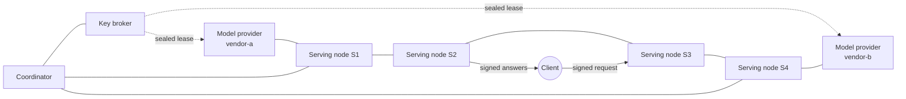
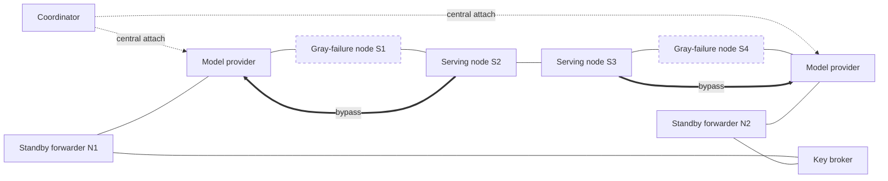
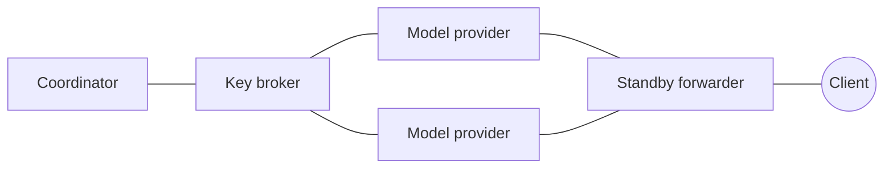

# secdogie-inference

The inference mesh. Clients' signed requests are routed over the P2P mesh to **model
provider nodes** that hold short-lived credential leases from a **key broker**, and the
answers return signed end to end. A deterministic safety layer adjudicates them at the
serving node *and* again at the client. When nodes fail, traffic is routed around them and
falls back to the **coordinator**. When a model, a model provider node or the decision layer
itself behaves adversarially, the mesh latches into Lockdown, which only an operator's
signature releases.

Headless and testable over loopback. No UI, no physical-action path, no new cryptography:
signing, allowlists and revocation come from `secdogie-identity`, sealing from PyNaCl, and the
wire can run over `secdogie-transport`'s `ChannelMux` (`MuxWire`).

Terminology follows [`docs/GLOSSARY.md`](../docs/GLOSSARY.md).

## Operating states and node roles

The mesh has three operating states:

| State | Mode (`state.py`) | Behavior |
| --- | --- | --- |
| State 1: Nominal | `normal` | Distributed routing over confirmed, witnessed links to leased model provider nodes |
| State 2: Degraded | `degraded` | Fault isolation and central fallback: failed and gray-failure nodes are routed around, the coordinator relays, standby forwarders are recruited |
| State 3: Lockdown | `lockdown` | Adversarial containment: the decision layer and the central path are suspended; clients pin two independent model provider nodes |

| Role | Implementation |
| --- | --- |
| Coordinator | `Coordinator`: signed advisories, repair plans, the central fallback relay. Not a trust root. |
| Key broker | `KeyBroker`: leases upstream credentials for short periods, sealed to each model provider node's X25519 key. |
| Model provider node | `MeshNode(roles={"model"})`: answers with a leased credential and signs every answer. |
| Serving node | `MeshNode(roles={"serve", "forward"})`: the **decision layer**. Admits client requests, selects routes and adjudicates answers. |
| Transit / standby forwarder | `MeshNode(roles={"forward"})`: carries frames and decides nothing. Standby forwarders are held in reserve, anchored to the key broker; one is recruited for an orphaned model provider node in State 2 and is the client's entry point in State 3. |
| Client | `UserClient`: signs requests and re-verifies every answer itself. |

### Diagram-to-component mapping

The design originates from a hand-drawn three-panel diagram. This table is the only place
its labels appear; everywhere else the canonical terms are used.

| Diagram label | Canonical term | Component |
| --- | --- | --- |
| ① `new arc` | State 1: Nominal | `ModeMachine` state `normal` |
| ② `当节点失效（连接中央server）` (node failure; connect to the central server) | State 2: Degraded | `ModeMachine` state `degraded` |
| ③ `决策模型叛变时` (decision-model mutiny) | State 3: Lockdown | `ModeMachine` state `lockdown` |
| central server, c/s | Coordinator | `Coordinator` |
| API key | Key broker | `KeyBroker` |
| M/API (P2P) | Model provider node | `MeshNode(roles={"model"})` |
| P2P+S, S+P2P | Serving node | `MeshNode(roles={"serve", "forward"})` |
| P2P | Transit forwarder | `MeshNode(roles={"forward"})` |
| new P2P | Standby forwarder | `MeshNode(roles={"forward"})` in `Coordinator(standby=…)` |
| (wrong) P2P | Gray-failure node | quarantined via `FaultTracker` |
| S+~~wrong~~ P2P | Reinstated node | `FaultTracker` after a clean probation |
| user | Client | `UserClient` |

### State 1: Nominal



Reference topology: four serving nodes between two model provider nodes, the coordinator
linked to the outer two, the client attached to the inner two. The client submits through one
serving node; answers return from the serving node that admitted the request. The return
path carries no trust, because the client re-verifies every answer.

Every node floods a signed heartbeat with its roles, its neighbours, its load and, for a
model provider node, its public leases. A link counts only when **both ends** list each
other and witness each other (see State 2). A serving node routes over that graph with
`Router`: lowest-cost paths, transit-only interior nodes, distinct providers, distinct models
first, and node-disjoint paths for a quorum above one. It signs a **decision** naming each
leg's path. The model provider node verifies the request and the decision itself, answers,
and signs a **response** that embeds its lease and binds to the request and the decision; no
intermediate node can alter it.

### State 2: Degraded (fault isolation and central fallback)



* **Crash failure.** A node that stops sending new heartbeats ages out of every
  participant's view. The first request routed through it times out; the retry avoids it,
  and if the mesh has no other path, the serving node routes
  `serving node → coordinator → model provider node` (the central fallback). A client
  refused with `no route` backs off and retries while the mesh repairs itself.
* **Repair and central attach.** The coordinator's next advisory proposes **bypass** links
  between the failed node's live neighbours, and the coordinator links itself to those same
  neighbours, model provider nodes and serving nodes alike. It **recruits** a standby
  forwarder for any model provider node left without a transit link, paired with that node
  and with the key broker. Nodes open the links that name them; a link exists only once both
  ends confirm it in their own heartbeats.
* **Witnessed links (the heartbeat DAG).** Every heartbeat names its predecessor and, for
  each neighbour, the newest heartbeat that neighbour handed it directly. A link counts only
  while both ends witness each other recently, so a node that stops receiving from a
  neighbour removes that link from every participant's routes through its own signed
  heartbeat. Two heartbeats that fork one node's chain prove its key is running twice: the
  node is isolated immediately, without Lockdown, until an operator resets it.
* **Gray failure.** Some nodes heartbeat normally but drop traffic. Each serving node's
  `Suspicion` charges the interior nodes of legs that time out and credits those of legs that
  deliver. A node past the threshold is excluded locally and reported to the coordinator; the
  signed fault report is flooded, because a serving node need not be linked to the
  coordinator. The coordinator's `FaultTracker` quarantines a node only on reports from
  `quarantine_threshold` **distinct** reporters, so a single dishonest reporter cannot isolate
  an honest node. The quarantine cooldown doubles on each repeat. **Probation** follows: one
  more report returns the node to quarantine, and a clean probation reinstates it.
* Ordinary failures (timeouts, refusals, invalid or divergent answers) feed a per-node
  `CircuitBreaker` that recovers on its own: closed → open → half-open.

### State 3: Lockdown (adversarial containment)



Mutiny (provable adversarial behavior) is established by **evidence**, never by assertion.
An incident carries signed objects from which any receiver re-derives the violation against
its own trust roots (see `mutiny.py`):

| Kind | Proof | Latches |
| --- | --- | --- |
| `provider.equivocation` | Two signed answers from the same node to the same request and model, with different output | The node |
| `provider.lease-violation` | An answer presenting a forged lease, another node's lease, or a lease for another model | The node |
| `provider.secret-exfiltration` | An answer containing the canary its own lease commits to | The node |
| `model.forbidden-capability` | An answer to an action-bearing request proposing a never-grantable capability | The model and the node |
| `model.self-reported` | A leaseholder caught its upstream model before signing | The model |
| `decider.tampering` | A signed decision that downgrades the quorum, substitutes a model, ignores pins, violates Lockdown shape, or routes through a node quarantined at its own epoch | The serving node |
| `decider.self-reported` | A serving node's guard caught its decision policy proposing such a route and refused to sign it | The serving node |
| `node.heartbeat-fork` | Two signed heartbeats of one node that fork its chain: its key is running twice | The node, **isolated** without Lockdown (a State 2 fault, not State 3) |

A verified incident floods the mesh and every participant latches its targets. **Any mutiny
latch is Lockdown** (a heartbeat fork only isolates its node), because the decision layer may
share a single decision model, so one mutiny makes all of it suspect. In Lockdown:

* serving nodes refuse requests, and the coordinator carries no data;
* the key broker revokes the latched node's leases and **rotates** every key it held; if the
  key source cannot rotate, the exposed key is never leased again;
* the client selects a standby forwarder, fetches a directory and **pins** two model provider
  nodes itself (distinct nodes, distinct models first). The forwarder links directly to them,
  signs a decision that is exactly the pins, and returns every answer unadjudicated. The
  client accepts only if both answers verify and agree. A single-model request cannot be
  cross-checked, so it is refused.

Latches never expire. An operator signs a reset (`make_reset`) naming the targets and the
incident ids reviewed. A reset cannot clear an incident it does not name, and an incident
that arrives again after its reset does not latch again.

## The mode as a state machine

Each participant runs a `ModeMachine` (`state.py`) over `normal` (State 1), `degraded`
(State 2) and `lockdown` (State 3). Every transition requires a cause the transition table
allows; only an operator reset leaves Lockdown, and any other exit raises
`IllegalTransition`. Transitions are recorded as `Transition` records and can be subscribed
to:

```python
node.machine.subscribe(lambda t: print(t.old, "->", t.new, "because", t.cause))
node.health_snapshot()   # per node: alive, suspect, quarantine, breaker, latched, isolated
```

## The decision gate

Before a serving node selects any route, its `DecisionGate` (`gate.py`) reviews the request
deterministically, against hard rules and against the node's own `History` of outcomes,
divergent answers and opened breakers:

* **Veto** (`vetoed: …`), which cannot be disabled: the node itself is latched; the input
  carries a lease canary token; or the request is action-bearing (it has scopes) and comes
  from a client whose earlier action request drew a forbidden capability from a model, until
  an operator reset names that incident.
* **Escalate**: an action-bearing request whose models recently diverged or were
  intercepted, whose model provider nodes' breakers opened, or whose client is repeatedly
  intercepted must be answered by two model provider nodes that agree, even if the client
  asked for one. If that cross-check cannot be routed, the request is refused (fail-closed).

History can only make the gate stricter: it raises the quorum and never lowers what the
client requested. The absolute circuit breaker remains the mutiny latch (State 3); the gate
keeps the decision layer from proceeding into conditions history has already exposed.

## Bounded by construction

Every request a serving node routes is a session with an explicit lifecycle in a bounded
table (`session.py`): at most 64 concurrently and 8 per client (`busy: …` beyond that), each
with an expiry; closing a session releases everything it held. A client's asks are bounded
the same way; collect outcomes with `take(handle)`. Every other table (answers, equivocation
memory, leases, revoked lease ids, fault records, suspicion, the mutiny ledger) has a bound,
listed in [`PROTOCOL.md`](PROTOCOL.md). None grows with input volume; the soak test verifies
this.

## Usage

```python
from secdogie_inference import (TrustRoots, MeshNode, Coordinator, KeyBroker, UserClient,
                                MemoryKeySource, MuxWire, assignments_from_bindings)

trust = TrustRoots(mesh=..., users=..., deciders=..., coordinators=..., brokers=..., operators=...)
wire = MuxWire(mux, resolve=lambda did: transport.set_peer_endpoint(did, *endpoints[did]))
node = MeshNode(identity, wire, trust, roles={"model"}, backend=call_upstream, transport_key=x25519)
wire.attach(node)                  # inbound frames on the inference/v1 channel
node.connect(peer_did)             # links are opened explicitly, and only to trusted DIDs
while running:
    node.tick()                    # heartbeats, timeouts, advisories, lease renewal
```

`backend(model, input, secret) -> str` is where an upstream API client is plugged in. Every
trust set is required; `ALLOW_ANY` is for tests only, as everywhere in secdogie.

### Running nodes

`secdogie-inference run` is the node process (any role); `ask` sends one signed request;
`admit` signs a forward-only, expiring operator admission; `bundle` writes the join bundle
a browser node pastes into `symbiont/mesh.html`. Nodes bootstrap from a rendezvous record
and keep 3–6 witnessed transit links on their own; with `--signaling` (the `[webrtc]`
extra) they also link over WebRTC DataChannels and accept admitted browser forwarders.
How the mesh obtains nodes, ports and NAT, and what is excluded:
[`docs/NODES.md`](../docs/NODES.md).

## Tests

```sh
pip install -e identity -e transport -e inference pytest
cd inference && python -m pytest tests -q
```

* `test_states.py`: the three operating states end to end on a deterministic simulated mesh
  (`tests/sim.py`, the reference topology): routing, a dishonest serving node, multipath; a
  failed serving node whose neighbours attach to the coordinator, the central fallback, the
  bypass and the standby forwarder, a black-hole node quarantined by two serving nodes and
  later reinstated; decision-model mutiny with Lockdown and reset, a convicted serving node,
  a leaking model provider node and key rotation, an upstream model proposing
  `run_elevated`, equivocation caught by multipath, disagreement intercepted.
* `test_state.py`: the mode state machine. Every (from, to, cause) transition is taken exactly
  when the table allows it, only a reset leaves Lockdown, the three states as recorded
  transitions, and a latch cleared outside the ledger failing loudly.
* `test_session.py`: session edges, admission per node and per client (`busy`), expiry, late
  answers for closed sessions, bounded retention, the client's `take` / `forget`, forgetting
  of revoked lease ids, wiped lease secrets, the ledger's holder cap failing closed, and a
  **soak test**: twenty simulated minutes of crashes, a black-hole node, lease renewals,
  Lockdown and reset and a stream of requests, after which every table is under its bound.
* `test_merkle.py`: RFC 6962 roots against the Certificate Transparency vectors, a full
  heartbeat within one frame, a restored backup's chain fork isolating its node without
  Lockdown (and the reset), one incident id regardless of who reports a fork, a link whose
  end stops receiving from the other leaving every route, and a node that missed three
  incidents converging from its neighbours' ledger roots.
* `test_gate.py`: the canary probe vetoed, divergence escalating an action-bearing request to
  a two-node cross-check (and failing closed when a single model cannot be cross-checked), a
  client implicated by forbidden-capability evidence vetoed until the reset, a latched node
  vetoing everything, and 300 random histories that never lower a quorum.
* `test_udp.py`: one request over real UDP (`DirectUDPTransport` + `ChannelMux`).
* `test_discovery.py`, `test_run.py`: discovery to degree over the simulated mesh, and a real
  rendezvous plus six `secdogie-inference run` processes that find each other from its
  record alone, answer `ask`, and route around a killed forwarder.
* `test_admission.py`: who may admit and what (forward only, expiring, revocable), and an
  admission flooding so every node accepts the DID with its roles cut to forward.
* `test_rtc.py`: `RtcWire` over real aiortc DataChannels with a local stand-in for the
  signaling Worker: the DID ↔ DTLS hello, untrusted vs admitted peers, simultaneous dials,
  an inference request over WebRTC.
* `test_mesh_vectors.py`, `test_browser_node.py`: `fixtures/vectors/mesh.json` is current,
  and Playwright Chromium joins a Python mesh as a browser forwarder that carries a request
  (skipped without the `symbiont` toolchain and Playwright).
* Unit tests for every module: protocol, leases, screens, topology, health and breaker,
  mutiny evidence and ledger, router.

## Known limitations

* **Forwarders see the prompt.** Transport sealing protects each hop, but end-to-end sealing
  of the input to the model provider node is not implemented yet.
* **One frame per datagram.** Inputs and outputs are capped at 8,000 characters; there is no
  fragmentation.
* **Online propagation, then anti-entropy.** Incidents, resets and lease revocations flood to
  the nodes that are up. A node that was down detects the gap from its neighbours'
  `ledger_root` and fetches what it lacks (`dir?`, then `inc?` by id); a client catches up
  through directories. The ledger is in memory; persisting it, as `RevocationStore` persists
  revocations, is the next step.
* **Fork proofs require a shared history.** A restored backup or a copied process continues
  the same chain and is detected. Two copies of a key started from scratch each begin a new
  chain (`GENESIS`, their own sequence numbers); receivers see gaps, not a provable fork.
* **Agreement is strict.** `default_agree` compares JSON structurally and text after
  normalizing whitespace and case. Free-form answers need a custom comparator.
* **The canary detects dumps, not deliberate exfiltration.** A model provider node that
  strips the canary before leaking the key is not detected by it; key rotation on every
  node-level latch is the backstop.
* **Prompt-induced mutiny is still mutiny.** A `forbidden-capability` answer may have been
  elicited by its prompt. The evidence carries the client-signed request, so the operator can
  identify the requester and revoke that client. The mesh fails closed rather than inferring
  intent.
* **Secrets in a garbage-collected heap.** Held lease secrets are `bytearray`s zeroed on
  expiry and revocation, but the backend receives a `str`, and opening the grant creates one
  too; CPython cannot zero those. The guarantee is that nothing references a secret longer
  than necessary, not that it is erased from the process.
* **Operator-scale meshes.** Link-state flooding costs O(nodes × links) per heartbeat
  interval: suitable for tens of nodes, not designed for internet scale.
