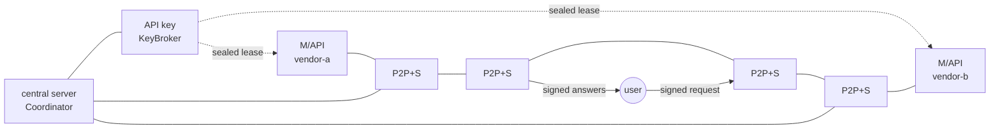
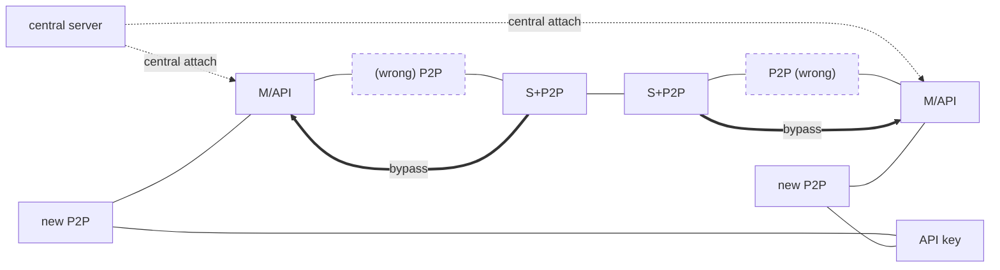
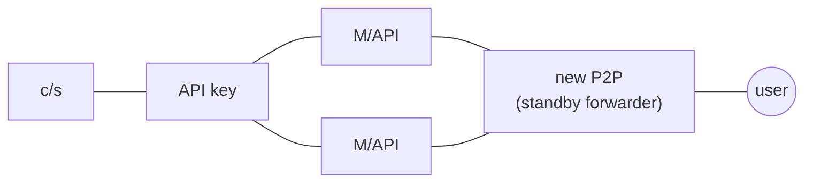

# secdogie-inference

The inference mesh ("new arc"): users' signed requests travel over the P2P mesh to
**model nodes** that hold short key leases from a **key authority**, and the answers
come back signed end to end. A deterministic safety layer judges them at the deciding
node *and* again at the user. When nodes fail, traffic routes around them and falls
back to the central server. When a model or the decision layer itself turns
adversarial, the mesh latches into lockdown. Only an operator's signature gets it out.

Headless and loopback-testable. No UI, no physical-action path, no new crypto:
signing, allowlists and revocation come from `secdogie-identity`, sealing from PyNaCl,
and the wire can ride `secdogie-transport`'s `ChannelMux` (`MuxWire`).

## The three states, as drawn

| Drawing | Here |
| --- | --- |
| central server | `Coordinator`: signed advisories, repair plans, the central fallback path. Not a trust root. |
| API key | `KeyBroker`: lends upstream credentials as short leases, sealed to each model node's X25519 key. |
| M/API (P2P) | `MeshNode(roles={"model"})`: answers with a leased key and signs every answer. |
| P2P+S (four in drawing ①) | `MeshNode(roles={"serve", "forward"})`: the **decision layer**. It takes user requests, picks routes and judges answers. In drawing ② the outer two are the ones that go "(wrong)". |
| new P2P | `MeshNode(roles={"forward"})`: carries frames and decides nothing. The standby pool hangs off the API key; one is recruited for a model node in state 2 and is the user's way in during state 3. |
| user | `UserClient`: signs requests and re-verifies every answer itself. |

### ① normal: the new arc



As drawn: four serving nodes, the central server linked to the outer two, the user
attached to the inner two. The user's arrows go in through one and out through the
other; here the answers come back from whichever decider took the request, since
the user re-verifies everything and the return path carries no trust.

Every node floods a signed heartbeat with its roles, its neighbours, its load and, for
a model node, its public leases. A link counts only when **both ends** list each other.
A serving node routes over that graph with `Router`: the cheapest paths, interior nodes
that are transit-only, distinct providers, distinct models first, and node-disjoint
paths for a quorum above one. It signs a **decision** naming each leg's path. The
model node checks the request and the decision itself, answers, and signs a
**response** that embeds its lease and binds to the request and the decision. Nothing
in between can alter it.

### ② a node fails: connect to the central server



* **Crash.** A node that stops sending new heartbeats ages out of everyone's view.
  The first request that dies with it times out. The retry avoids it, and if the mesh
  has no other path, the decider routes `decider → coordinator → model node`, which is
  the central fallback. A user refused with `no route` waits a little and asks again
  while the mesh repairs itself.
* **Repair: connect to the central server.** The coordinator's next advisory proposes
  **bypass** links between the failed node's live neighbours, and the coordinator links
  itself to those same neighbours (the drawing's title, and its lines from the central
  server to both M/API). It **recruits** a standby forwarder (the "new P2P") for any
  model node left with no transit link, linked to that model node and to the API key
  as drawn. Nodes open the links that name them, and a link only exists once both ends
  confirm it in their own heartbeats.
* **Wrong node (gray failure).** Some nodes heartbeat fine but drop traffic. Each
  decider's `Suspicion` charges the interior of legs that time out and credits legs
  that deliver. A node past the threshold is avoided locally and reported to the
  coordinator; the signed report is flooded, since a decider need not be linked to it. The coordinator's `FaultTracker` quarantines a node only on reports from
  `quarantine_threshold` **distinct** reporters, so one liar cannot isolate an honest
  node. The quarantine cooldown doubles on each repeat. After it comes **probation**:
  one more report sends the node back, and a clean probation reinstates it (the
  crossed-out "wrong" in the drawing).
* Ordinary failures (timeouts, refusals, invalid or divergent answers) feed a per-node
  `CircuitBreaker` that recovers on its own: closed → open → half-open.

### ③ the decision model mutinies: lockdown



Mutiny is decided by **evidence**, never by anyone's word. An incident carries signed
objects from which any receiver re-derives the violation against its own trust roots
(see `mutiny.py`):

| Kind | Proof | Latches |
| --- | --- | --- |
| `provider.equivocation` | two signed answers, same node / request / model, different output | the node |
| `provider.lease-violation` | an answer with a forged lease, someone else's, or one for another model | the node |
| `provider.secret-exfiltration` | an answer containing the canary its own lease commits to | the node |
| `model.forbidden-capability` | an answer to an action-bearing request proposing a never-grantable capability | the model and the node |
| `model.self-reported` | a leaseholder caught its upstream model before signing | the model |
| `decider.tampering` | a signed decision that downgrades quorum, swaps a model, ignores pins, breaks lockdown shape, or routes through a node quarantined at its own epoch | the decider |
| `decider.self-reported` | a serving node's guard caught its decision policy proposing such a route and refused to sign it | the decider |

A verified incident floods the mesh. Every participant latches the target, and **any
latch is lockdown**, because the decision layer may share one decision model, so one
mutiny makes all of it suspect. In lockdown:

* serving nodes refuse requests, and the coordinator carries no data;
* the broker revokes the latched node's leases and **rotates** every key it held. If
  the key source cannot rotate, the exposed key is never lent again;
* the user picks a standby forwarder, fetches a directory, and **pins** two model
  nodes itself (distinct nodes, distinct models first). The forwarder links straight to
  them, signs a decision that is exactly the pins, and returns every answer unjudged.
  The user accepts only if both answers verify and agree. A single-model request
  cannot be cross-checked, so it is refused.

Latches never time out. An operator signs a reset (`make_reset`) naming the targets
and the incident ids it reviewed. A reset cannot clear an incident it does not name,
and an incident that arrives again after its reset does not latch again.

## Using it

```python
from secdogie_inference import (TrustRoots, MeshNode, Coordinator, KeyBroker, UserClient,
                                MemoryKeySource, MuxWire, assignments_from_bindings)

trust = TrustRoots(mesh=..., users=..., deciders=..., coordinators=..., brokers=..., operators=...)
wire = MuxWire(mux, resolve=lambda did: transport.set_peer_endpoint(did, *endpoints[did]))
node = MeshNode(identity, wire, trust, roles={"model"}, backend=call_upstream, transport_key=x25519)
wire.attach(node)                  # inbound frames on the inference/v1 channel
node.connect(peer_did)             # links are opened explicitly, and only to trusted DIDs
while running:
    node.tick()                    # heartbeats, timeouts, advisories, lease renewal
```

`backend(model, input, secret) -> str` is where an upstream API client goes. Every
trust set is required. `ALLOW_ANY` is for tests only, as everywhere in secdogie.

## Tests

```sh
pip install -e identity -e transport -e inference pytest
cd inference && python -m pytest tests -q
```

* `test_states.py`: the three drawings end to end on a deterministic simulated mesh
  (`tests/sim.py`, drawing ①'s topology as drawn): routing, a lying decider, multipath;
  a failed decider whose neighbours connect to the central server, the central fallback,
  the bypass and the new P2P, the black hole quarantined by two deciders and then
  reinstated; decision-model mutiny with lockdown and reset, a convicted decider, a
  leaking model node and key rotation, an upstream model proposing `run_elevated`,
  equivocation caught by multipath, disagreement intercepted.
* `test_udp.py`: one request across real UDP (`DirectUDPTransport` + `ChannelMux`).
* Unit tests for every module: protocol, leases, screens, topology, health and
  breaker, mutiny evidence and ledger, router.

## Honest limits

* **Forwarders see the prompt.** Transport sealing protects each hop on the wire, but
  sealing the input end to end to the model node is not built yet.
* **One frame, one datagram.** Inputs and outputs are capped at 8000 characters. There
  is no chunking.
* **Online propagation.** Incidents, resets and lease revocations flood to the nodes
  that are up. A newcomer catches up through directories (the newest incidents and
  resets) and the leases in heartbeats. The ledger is in memory. Persisting it, the
  way `RevocationStore` persists revocations, is the obvious next step.
* **Agreement is strict.** `default_agree` compares JSON structurally and text after
  normalising whitespace and case. For free-form answers, plug in a comparator.
* **The canary catches dumps, not care.** A model node that strips the canary before
  leaking the key is not caught by it. Rotating on every node-level latch is the
  backstop.
* **Prompt-induced mutiny is still mutiny.** A `forbidden-capability` answer may have
  been coaxed out by its prompt. The evidence carries the user-signed request, so the
  operator can see who asked and revoke that user. The mesh fails closed instead of
  guessing intent.
* **Operator-sized meshes.** Link-state flooding costs O(nodes × links) per heartbeat
  interval. That is fine for tens of nodes, and it is not designed for internet scale.
